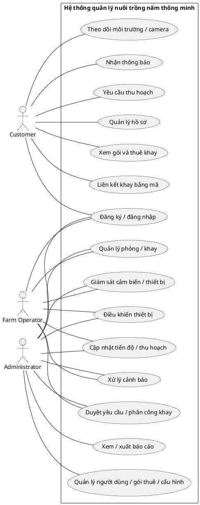
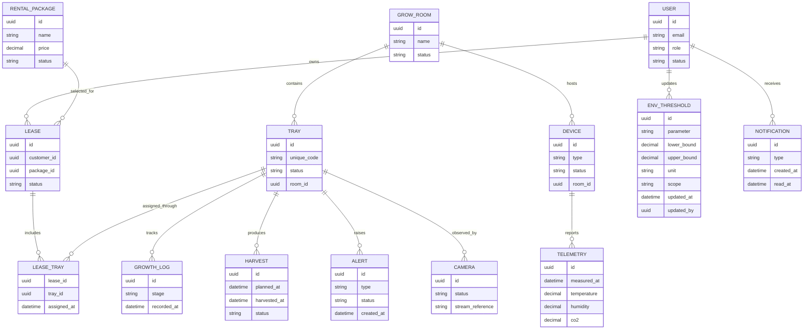

# Đặc tả yêu cầu phần mềm (SRS)

## 1. Giới thiệu

### 1.1 Mục đích

Tài liệu xác định phạm vi, tác nhân, yêu cầu chức năng và phi chức năng, quy tắc nghiệp vụ, giao diện ngoài, dữ liệu khái niệm và điều kiện lỗi của hệ thống. Đây là cơ sở để thiết kế, triển khai và kiểm thử phần mềm.

### 1.2 Phạm vi sản phẩm

Hệ thống số hóa hoạt động nuôi trồng nấm và dịch vụ cho thuê khay. Người vận hành giám sát phòng trồng, khay, cảm biến, thiết bị, tiến độ và thu hoạch trên Web. Khách hàng đăng ký/thuê khay và theo dõi khay của mình trên ứng dụng di động. Quản trị viên quản lý người dùng, cấu hình và báo cáo.

Phạm vi gồm:

- Web quản trị/vận hành: ReactJS.
- Ứng dụng khách hàng: Flutter
- Backend REST API: Java (Spring Boot).
- Cơ sở dữ liệu: PostgreSQL.
- IoT: ESP32, cảm biến nhiệt độ/độ ẩm/CO₂
- Camera phục vụ quan sát từ xa.

Ngoài phạm vi phiên bản MVP:

- Tích hợp cổng thanh toán trực tuyến; hệ thống chỉ ghi nhận yêu cầu thuê và trạng thái giao dịch mô phỏng, không thu/hoàn tiền.
- AI hoặc thị giác máy tính để chẩn đoán bệnh, phân loại nấm hay tự đánh giá chất lượng.
- Ghi hình/lưu trữ video camera; hệ thống chỉ cung cấp luồng trực tiếp không lưu video .
- Thương mại điện tử hoặc hệ thống logistics toàn diện ngoài yêu cầu nhận/giao sản phẩm thu hoạch.

## 2. Mô tả tổng quan

### 2.1 Bối cảnh hệ thống

```text
ESP32 + cảm biến/thiết bị ──> Backend Java/Spring Boot ──> PostgreSQL
                                       │
                          MQTT telemetry/lệnh; WebSocket cập nhật UI
                              ┌────────┴────────┐
                         Web ReactJS       Mobile Flutter
                       Admin / Operator       Customer
```

Thiết bị ESP32 trao đổi telemetry/lệnh qua MQTT mã hóa; Web/Mobile sử dụng HTTPS REST API và WebSocket để nhận cập nhật. Luồng camera được chuyển qua media gateway; MVP không lưu video.

### 2.2 Nhóm người dùng

| Tác nhân      | Mục tiêu và quyền chính                                                                                                      |
| ------------- | ---------------------------------------------------------------------------------------------------------------------------- |
| Administrator | Có toàn bộ quyền nghiệp vụ của Farm Operator; đồng thời quản lý tài khoản/vai trò, gói thuê, ngưỡng, báo cáo và xuất dữ liệu |
| Farm Operator | Quản lý vận hành phòng/khay, gán khay, theo dõi cảm biến, điều khiển thiết bị, cập nhật tiến độ/thu hoạch và xử lý cảnh báo  |
| Customer      | Quản lý hồ sơ, xem gói thuê, thuê/liên kết khay, theo dõi môi trường/tiến độ/camera, nhận thông báo và gửi yêu cầu thu hoạch |

Administrator kế thừa toàn bộ quyền nghiệp vụ của Farm Operator và có thêm quyền quản trị được quy định riêng; Farm Operator không có các quyền quản trị riêng này. Customer chỉ được truy cập chức năng và dữ liệu trong phạm vi tài khoản của mình.

Administrator đầu tiên phải được khởi tạo qua quy trình được ủy quyền, không qua đăng ký công khai.

### 2.3 Ràng buộc và phụ thuộc

- Backend sử dụng Java/Spring Boot, PostgreSQL, REST API và MQTT broker;
- Web sử dụng ReactJS; Mobile sử dụng Flutter;
- Thiết bị IoT gửi mẫu telemetry mặc định mỗi 30 giây; thiết bị cần được đăng ký và cấp thông tin xác thực duy nhất;
- MVP nghiệm thu với quy mô tham chiếu 5 phòng, 50 khay, 50 thiết bị và 10 người dùng đồng thời;
- Web hỗ trợ 3 phiên bản ổn định gần nhất của Chrome và Edge; Mobile hỗ trợ Android 10 trở lên và iOS 15 trở lên.

### 2.4 Giả định

- Mỗi khay có mã định danh duy nhất trong hệ thống.
- Người dùng truy cập theo tài khoản và vai trò được cấp.
- Thiết bị được đăng ký với một phòng trồng trước khi gửi telemetry hoặc nhận lệnh.
- Khách hàng chỉ được xem khay và dữ liệu được liên kết hợp lệ với tài khoản của mình.
- Admin/Operator tự cấu hình ngưỡng môi trường dùng chung của trang trại trên giao diện; Customer chỉ xem dữ liệu trong phạm vi tài khoản và không thay đổi ngưỡng.
- Khách hàng thuê theo gói; Operator/Admin duyệt yêu cầu và phân công khay theo quyền kế thừa; mã liên kết được cấp một lần, hết hạn sau 24 giờ.

## 3. Yêu cầu chức năng

### 3.1 Danh mục yêu cầu

| Mã                 | Yêu cầu                                        | Ưu tiên | Input                                                                                       | Processing Logic                                                                                                                                                                                                | Output                                                                              | Quy tắc / lỗi                                                              |
| ------------------ | ---------------------------------------------- | ------: | ------------------------------------------------------------------------------------------- | --------------------------------------------------------------------------------------------------------------------------------------------------------------------------------------------------------------- | ----------------------------------------------------------------------------------- | -------------------------------------------------------------------------- |
| `FR-AUTH-REG-001`  | Đăng ký khách hàng                             |      P0 | Họ tên, email, mật khẩu, số điện thoại không bắt buộc                                       | Validate dữ liệu; tạo Customer ở trạng thái EMAIL_UNVERIFIED; phát token xác minh một lần                                                                                                                       | ID tài khoản và trạng thái chờ xác minh                                             | BR-SEC-001; ERR-AUTH-422-01, ERR-AUTH-409-01                               |
| `FR-AUTH-LOG-001`  | Đăng nhập                                      |      P0 | Email và mật khẩu                                                                           | Kiểm tra xác thực, trạng thái, email đã xác minh và ngưỡng khóa; tạo phiên 30 phút nếu hợp lệ                                                                                                                   | Kết quả xác thực, phiên 30 phút và hồ sơ/role                                       | BR-SEC-002; ERR-AUTH-401-01, ERR-AUTH-403-01, ERR-AUTH-423-01              |
| `FR-AUTH-VER-001`  | Xác minh địa chỉ email                         |      P1 | Email và mã/token xác minh                                                                  | Phát email xác minh và xác nhận token một lần còn hiệu lực trong 15 phút                                                                                                                                        | Trạng thái email đã xác minh hoặc lỗi                                               | BR-SEC-001; ERR-AUTH-401-01, ERR-AUTH-422-01                               |
| `FR-AUTH-PWD-001`  | Đổi mật khẩu                                   |      P1 | Mật khẩu hiện tại và mật khẩu mới                                                           | Xác minh mật khẩu hiện tại, áp dụng chính sách mật khẩu và thu hồi phiên refresh khác                                                                                                                           | Kết quả đổi mật khẩu                                                                | BR-SEC-002; ERR-AUTH-401-01, ERR-VAL-422-01                                |
| `FR-AUTH-REC-001`  | Khôi phục mật khẩu                             |      P1 | Email và token khôi phục                                                                    | Gửi token dùng một lần qua email; token hết hạn sau 15 phút; cập nhật mật khẩu và thu hồi phiên cũ                                                                                                              | Phản hồi chung không tiết lộ email tồn tại; kết quả cập nhật                        | BR-SEC-002; ERR-AUTH-401-01, ERR-VAL-422-01                                |
| `FR-AUTH-END-001`  | Đăng xuất                                      |      P1 | Phiên hiện tại                                                                              | Thu hồi refresh token/phiên hiện tại và xóa trạng thái xác thực phía client                                                                                                                                     | Xác nhận đăng xuất                                                                  | BR-SEC-002; ERR-AUTH-401-01                                                |
| `FR-AUTH-ADM-001`  | Khởi tạo tài khoản Administrator,Farm Operator |      P1 | Thông tin quản trị và quy trình cấp quyền                                                   | Tạo tài khoản quản trị qua quy trình được ủy quyền; không mở đăng ký Admin/ Farm Operator công khai nếu chưa được phê duyệt                                                                                     | ID tài khoản trạng thái khởi tạo                                                    | BR-SEC-003; ERR-AUTH-403-01, ERR-AUTH-409-01                               |
| `FR-USER-MGT-001`  | Quản lý người dùng                             |      P0 | Hồ sơ, vai trò, trạng thái tài khoản, thao tác quản trị                                     | Kiểm tra quyền Admin và tính hợp lệ; tạo/cập nhật/vô hiệu hóa/xóa tài khoản, gán vai trò hoặc đặt lại mật khẩu                                                                                                  | Hồ sơ/trạng thái tài khoản sau cập nhật hoặc kết quả thao tác                       | BR-SEC-003; ERR-AUTH-403-01, ERR-USER-404-01, ERR-USER-409-01              |
| `FR-USER-PRO-001`  | Quản lý hồ sơ cá nhân                          |      P1 | Thông tin hồ sơ cần xem/cập nhật                                                            | Chỉ cho phép đọc và sửa các trường được phép của tài khoản hiện tại                                                                                                                                             | Hồ sơ đã cập nhật hoặc được trả về                                                  | ERR-AUTH-401-01, ERR-VAL-422-01                                            |
| `FR-FARM-ROOM-001` | Quản lý phòng trồng                            |      P0 | Mã/tên phòng, mô tả, trạng thái, thao tác                                                   | Admin/Operator tạo, xem, sửa; chặn xóa cứng khi còn tài nguyên/quan hệ sử dụng                                                                                                                                  | Bản ghi phòng hoặc danh sách phòng                                                  | BR-FARM-001; ERR-VAL-422-01, ERR-FARM-404-01, ERR-FARM-409-01              |
| `FR-FARM-TRAY-001` | Quản lý khay trồng                             |      P0 | Mã khay, phòng, trạng thái, thuộc tính khay                                                 | Admin/Operator tạo/cập nhật/xem; xác thực mã duy nhất và trạng thái gán                                                                                                                                         | Bản ghi khay hoặc danh sách khay                                                    | BR-FARM-001, BR-RENT-001; ERR-VAL-422-01, ERR-TRAY-404-01, ERR-TRAY-409-01 |
| `FR-RENT-PKG-001`  | Quản lý gói thuê                               |      P0 | Tên gói, giá, thời hạn, mô tả, trạng thái                                                   | Admin tạo/cập nhật/ẩn; chỉ hiển thị gói hoạt động cho khách hàng                                                                                                                                                | Gói thuê hoặc danh sách gói được phép xem                                           | BR-RENT-002; ERR-VAL-422-01, ERR-PKG-404-01                                |
| `FR-RENT-ORD-001`  | Đăng ký thuê khay                              |      P0 | Gói thuê, số lượng 1–5, thông tin Customer                                                  | Kiểm tra gói và khả năng cung cấp; tạo yêu cầu PENDING; không phát sinh thanh toán thật                                                                                                                         | ID yêu cầu thuê và trạng thái xử lý                                                 | BR-RENT-002, BR-RENT-003; ERR-RENT-409-01, ERR-VAL-422-01                  |
| `FR-RENT-LNK-001`  | Liên kết khay bằng mã                          |      P0 | Mã khay và tài khoản hiện tại                                                               | Xác thực mã, trạng thái thuê/phân công và quyền; liên kết chỉ khi hợp lệ                                                                                                                                        | Bản ghi liên kết khay-khách hàng                                                    | BR-RENT-001, BR-RENT-003; ERR-TRAY-404-01, ERR-TRAY-409-01                 |
| `FR-RENT-INF-001`  | Xem khay thuê                                  |      P0 | ID khay hoặc truy vấn danh sách khay tài khoản                                              | Kiểm tra liên kết/quyền; lấy trạng thái, tiến độ và lịch thu hoạch nếu có                                                                                                                                       | Chi tiết khay hoặc danh sách khay Customer được xem                                 | BR-RENT-003; ERR-AUTH-403-01, ERR-TRAY-404-01                              |
| `FR-RENT-HIS-001`  | Xem lịch sử thuê và giao dịch                  |      P1 | Tài khoản hiện tại, bộ lọc thời gian/trạng thái                                             | Lọc bản ghi theo Customer hiện tại và tiêu chí hợp lệ                                                                                                                                                           | Danh sách lượt thuê/giao dịch mô phỏng thuộc tài khoản                              | BR-SEC-003, BR-RENT-003; ERR-AUTH-403-01                                   |
| `FR-IOT-DEV-001`   | Quản lý thiết bị IoT/camera                    |      P0 | ID thiết bị, loại, phòng, cấu hình/trạng thái                                               | Admin đăng ký/cập nhật; Operator thực hiện thao tác vận hành thiết bị được giao; xác thực định danh duy nhất và liên kết phòng                                                                                  | Hồ sơ thiết bị và trạng thái hiện tại                                               | BR-IOT-001; ERR-VAL-422-01, ERR-IOT-404-01, ERR-IOT-409-01                 |
| `FR-CAM-MGT-001`   | Quản lý camera và luồng quan sát               |      P1 | Camera, phòng/khay, cấu hình luồng và trạng thái                                            | Admin/Operator quản lý liên kết camera/kiểm tra luồng; Customer chỉ được xem camera theo quyền trên khay                                                                                                        | Thông tin camera/luồng và trạng thái kiểm tra                                       | BR-SEC-003, BR-RENT-003; ERR-AUTH-403-01, ERR-IOT-404-01, ERR-CAM-503-01   |
| `FR-IOT-TLM-001`   | Thu nhận và xem dữ liệu môi trường             |      P0 | ID thiết bị, nhiệt độ, độ ẩm, CO₂, thời điểm đo                                             | Xác thực thiết bị, đơn vị và payload; lưu mẫu đo; Admin/Operator xem dữ liệu vận hành theo quyền tài nguyên, Customer chỉ xem dữ liệu khay thuộc tài khoản                                                      | Xác nhận tiếp nhận hoặc dữ liệu môi trường mới nhất                                 | BR-IOT-001; ERR-IOT-401-01, ERR-VAL-422-01, ERR-IOT-503-01                 |
| `FR-IOT-CTL-001`   | Điều khiển thiết bị môi trường                 |      P0 | Thiết bị, lệnh, người yêu cầu                                                               | Admin kế thừa quyền điều khiển thủ công của Operator; kiểm tra quyền/trạng thái và điều kiện an toàn, gửi lệnh và chờ ACK tối đa 10 giây                                                                        | Trạng thái lệnh: được xác nhận, thất bại hoặc chưa xác định                         | BR-IOT-002; ERR-AUTH-403-01, ERR-IOT-404-01, ERR-IOT-503-01                |
| `FR-IOT-AUTO-001`  | Điều khiển tự động theo ngưỡng                 |      P1 | Ngưỡng hợp lệ đang hiệu lực và telemetry                                                    | Chỉ thực hiện theo cấu hình đã lưu, phạm vi và điều kiện an toàn; không phát lệnh khi chưa có ngưỡng hợp lệ                                                                                                     | Lệnh điều khiển và kết quả xử lý hoặc trạng thái chưa cấu hình                      | BR-IOT-002, BR-IOT-003; ERR-IOT-503-01                                     |
| `FR-IOT-HIS-001`   | Xem lịch sử cảm biến/thiết bị                  |      P1 | Phòng/khay/thiết bị, khoảng thời gian                                                       | Admin/Operator xem dữ liệu vận hành theo quyền tài nguyên; Customer chỉ xem dữ liệu khay thuộc tài khoản                                                                                                        | Danh sách mẫu đo và sự kiện trạng thái thiết bị                                     | BR-IOT-001, BR-SEC-003; ERR-AUTH-403-01, ERR-VAL-422-01, ERR-IOT-404-01    |
| `FR-CAM-STR-001`   | Xem camera khay thuê                           |      P1 | ID khay, tài khoản Customer, yêu cầu xem luồng                                              | Xác minh liên kết khay và quyền; chỉ cấp thông tin truy cập luồng hợp lệ                                                                                                                                        | Thông tin/URL truy cập luồng hoặc trạng thái không khả dụng                         | BR-RENT-003; ERR-AUTH-403-01, ERR-CAM-503-01                               |
| `FR-CROP-PRG-001`  | Cập nhật tiến độ nuôi trồng                    |      P0 | Khay, giai đoạn, ghi chú, thời điểm                                                         | Admin kế thừa quyền vận hành của Operator; kiểm tra quyền trên khay và trạng thái; lưu sự kiện cùng người cập nhật                                                                                              | Bản ghi tiến độ mới và trạng thái khay                                              | BR-CROP-001, BR-SEC-003; ERR-AUTH-403-01, ERR-VAL-422-01, ERR-TRAY-404-01  |
| `FR-HARV-SCH-001`  | Quản lý lịch và nhật ký thu hoạch              |      P0 | Khay, thời điểm dự kiến/thực tế, sản lượng, ghi chú                                         | Admin kế thừa quyền vận hành của Operator; tạo/cập nhật lịch, ghi nhật ký theo trạng thái và kiểm tra dữ liệu bắt buộc                                                                                          | Lịch hoặc nhật ký thu hoạch được lưu                                                | BR-CROP-002, BR-SEC-003; ERR-AUTH-403-01, ERR-VAL-422-01, ERR-TRAY-404-01  |
| `FR-ALRT-ENV-001`  | Phát hiện bất thường môi trường                |      P0 | Telemetry, cấu hình ngưỡng hợp lệ, trạng thái thiết bị                                      | So sánh với ngưỡng dưới/trên đang có hiệu lực; mở cảnh báo sau 2 mẫu liên tiếp ngoài dải và đóng sau 2 mẫu liên tiếp trở lại trong dải; không cảnh báo vượt ngưỡng khi chưa cấu hình hoặc khi giá trị trong dải | Bản ghi cảnh báo hoặc trạng thái chưa cấu hình có nguyên nhân, giá trị và thời điểm | BR-IOT-003; ERR-VAL-422-01                                                 |
| `FR-ALRT-NOT-001`  | Gửi và xem thông báo                           |      P1 | Sự kiện tiến độ, cảnh báo, thu hoạch, tài khoản nhận                                        | Lưu thông báo, xác định người nhận theo quyền; Admin/Operator chỉ xem thông báo vận hành được phép, Customer chỉ thông báo thuộc tài khoản/khay của mình                                                        | ID/trạng thái thông báo và danh sách thông báo người dùng được xem                  | BR-SEC-003, BR-RENT-003; ERR-AUTH-403-01, ERR-NOT-503-01                   |
| `FR-HARV-REQ-001`  | Gửi yêu cầu nhận/giao thu hoạch                |      P1 | Khay, phương thức nhận/giao, thông tin liên hệ                                              | Kiểm tra quyền và điều kiện sẵn sàng; tạo yêu cầu cho Operator/Admin xử lý                                                                                                                                      | ID yêu cầu và trạng thái xử lý ban đầu                                              | BR-CROP-002, BR-RENT-003; ERR-AUTH-403-01, ERR-HARV-409-01                 |
| `FR-RPT-VIEW-001`  | Xem báo cáo và thống kê                        |      P1 | Bộ lọc thời gian/phòng/gói                                                                  | Xác thực quyền; tổng hợp dữ liệu vận hành, môi trường, thuê và thu hoạch                                                                                                                                        | Báo cáo/tập số liệu theo bộ lọc                                                     | BR-SEC-003; ERR-AUTH-403-01, ERR-VAL-422-01                                |
| `FR-RPT-EXP-001`   | Xuất dữ liệu báo cáo                           |      P2 | Loại báo cáo, bộ lọc thời gian tối đa 12 tháng                                              | Kiểm tra quyền và giới hạn 10.000 dòng; xuất CSV UTF-8 và ghi nhận kết quả                                                                                                                                      | Tệp CSV hoặc trạng thái lỗi                                                         | BR-SEC-003; ERR-AUTH-403-01, ERR-VAL-422-01, ERR-SYS-503-01                |
| `FR-CONF-THR-001`  | Cấu hình ngưỡng môi trường                     |      P0 | Phạm vi dùng chung toàn trang trại; nhiệt độ (°C), độ ẩm (%RH), CO₂ (ppm); ngưỡng dưới/trên | Admin/Operator xem cấu hình hiện tại; thêm/chỉnh sửa và lưu ngưỡng; xác thực giá trị số, ngưỡng dưới không lớn hơn ngưỡng trên và đơn vị nhất quán; không lưu nếu không hợp lệ                                  | Cấu hình hiệu lực/đã lưu và trạng thái chưa cấu hình nếu chưa có cấu hình hợp lệ    | BR-SEC-003, BR-IOT-003; ERR-AUTH-403-01, ERR-VAL-422-01                    |

### 3.2 Quy tắc nghiệp vụ

| Mã BR         | Quy tắc                         | Phát biểu WHEN / THEN / UNLESS                                                                                                                                                                                                                                                                                                                                                                                                                                                                                                                                                                                                                                                                                      | Cách áp dụng baseline                                                                            |
| ------------- | ------------------------------- | ------------------------------------------------------------------------------------------------------------------------------------------------------------------------------------------------------------------------------------------------------------------------------------------------------------------------------------------------------------------------------------------------------------------------------------------------------------------------------------------------------------------------------------------------------------------------------------------------------------------------------------------------------------------------------------------------------------------- | ------------------------------------------------------------------------------------------------ |
| `BR-SEC-001`  | Định danh và xác minh tài khoản | KHI tạo Customer THEN email phải duy nhất và được xác minh trước khi dùng chức năng thuê; token xác minh một lần hết hạn sau 15 phút                                                                                                                                                                                                                                                                                                                                                                                                                                                                                                                                                                                | Email là định danh đăng nhập                                                                     |
| `BR-SEC-002`  | Phiên và mật khẩu               | KHI đăng nhập thành công THEN access token hết hạn sau 30 phút, refresh session sau 7 ngày; đăng xuất/đổi/khôi phục mật khẩu thu hồi refresh session; KHI sai mật khẩu 5 lần trong 15 phút THEN khóa đăng nhập tài khoản 15 phút                                                                                                                                                                                                                                                                                                                                                                                                                                                                                    | Mật khẩu tối thiểu 12 ký tự; hash Argon2id                                                       |
| `BR-SEC-003`  | Phân quyền                      | KHI có yêu cầu thao tác THEN backend xác thực người dùng và kiểm tra quyền trên chức năng/tài nguyên trước khi thực hiện; quyền/role chỉ được xác định từ nguồn dữ liệu đáng tin cậy phía backend, không lấy từ client; Admin có toàn bộ quyền Operator và quyền quản trị riêng được quy định; Operator chỉ có quyền vận hành, không có quyền quản trị riêng; Customer chỉ truy cập phạm vi tài khoản của mình; yêu cầu không được phép bị từ chối bằng `ERR-AUTH-403-01` (phiên chưa xác thực bằng `ERR-AUTH-401-01`)                                                                                                                                                                                              | Tài khoản Admin đầu tiên khởi tạo qua quy trình được ủy quyền, không đăng ký công khai           |
| `BR-FARM-001` | Trạng thái tài nguyên           | KHI phòng/khay có lease, lịch sử hoặc dữ liệu liên quan THEN chỉ cho phép lưu trữ/ngừng hoạt động, không xóa cứng; thao tác phải được ghi audit                                                                                                                                                                                                                                                                                                                                                                                                                                                                                                                                                                     | Lưu trữ thay cho xóa cứng                                                                        |
| `BR-RENT-001` | Mã khay và liên kết             | KHI gán khay THEN mã khay duy nhất; mã liên kết một lần, gắn với một Customer, hết hạn sau 24 giờ; mỗi khay chỉ có tối đa một lease ACTIVE                                                                                                                                                                                                                                                                                                                                                                                                                                                                                                                                                                          | Mã được tạo sau khi Operator/Admin phân công                                                     |
| `BR-RENT-002` | Điều kiện và trạng thái thuê    | KHI gửi yêu cầu THEN gói phải ACTIVE, số lượng từ 1 đến 5; luồng yêu cầu PENDING → APPROVED → ASSIGNED → ACTIVE → COMPLETED; nhánh REJECTED/CANCELLED; Customer hủy trước ASSIGNED, Operator/Admin hủy sau ASSIGNED với lý do; transaction demo chuyển SIMULATED → SIMULATED_CONFIRMED/SIMULATED_REJECTED                                                                                                                                                                                                                                                                                                                                                                                                           | Giá VND, kỳ hạn ngày; transaction demo không đại diện cho thu/hoàn tiền                          |
| `BR-RENT-003` | Phạm vi dữ liệu khách hàng      | KHI Customer truy cập khay, telemetry, camera, thông báo hoặc thu hoạch THEN chỉ trả dữ liệu khay có lease ACTIVE và liên kết hợp lệ; Admin/Operator chỉ được truy cập dữ liệu vận hành cần thiết cho thao tác/tài nguyên được phép, không mặc nhiên truy cập toàn bộ hồ sơ hoặc dữ liệu cá nhân Customer                                                                                                                                                                                                                                                                                                                                                                                                           | Không chia sẻ mặc định; lọc phạm vi ở backend                                                    |
| `BR-IOT-001`  | Định dạng và xác thực IoT       | KHI nhận message THEN thiết bị dùng MQTT qua TLS 1.2+, credential riêng; payload JSON gồm deviceId, messageId, measuredAt UTC, metric và unit; QoS 1, loại trùng theo messageId                                                                                                                                                                                                                                                                                                                                                                                                                                                                                                                                     | Nhiệt độ °C, độ ẩm %RH, CO₂ ppm                                                                  |
| `BR-IOT-002`  | An toàn điều khiển              | KHI phát lệnh THEN lưu commandId, actor/automation, thời điểm và ACK; timeout ACK sau 10 giây thì trạng thái UNKNOWN/FAILED, không báo thành công; manual override dừng automation cho tới khi Operator/Admin bật lại theo điều kiện an toàn                                                                                                                                                                                                                                                                                                                                                                                                                                                                        | Mất kết nối/cảm biến stale thì không phát lệnh tự động                                           |
| `BR-IOT-003`  | Ngưỡng môi trường               | Admin/Operator được xem, nhập, chỉnh sửa và lưu ngưỡng nhiệt độ, độ ẩm, CO₂ trên giao diện; backend chỉ lưu khi giá trị số hợp lệ, đơn vị nhất quán và ngưỡng dưới không lớn hơn ngưỡng trên. Khi nhận telemetry, hệ thống dùng cấu hình hợp lệ đang có hiệu lực: giá trị thấp hơn ngưỡng dưới hoặc cao hơn ngưỡng trên được tính là ngoài dải; chỉ tạo cảnh báo theo cơ chế 2 mẫu hợp lệ liên tiếp ngoài dải và đóng sau 2 mẫu liên tiếp trở lại trong dải. Giá trị trong dải không tạo cảnh báo vượt ngưỡng. Khi chưa có cấu hình hợp lệ cho thông số/phạm vi, không dùng ngưỡng mặc định/giả định, không kết luận dữ liệu bình thường và không tạo cảnh báo vượt ngưỡng; giao diện hiển thị chưa cấu hình ngưỡng | Mô phỏng; Admin/Operator tự nhập; auto mặc định OFF và vẫn tuân thủ điều kiện an toàn điều khiển |
| `BR-CROP-001` | Giai đoạn nuôi                  | KHI cập nhật tiến độ THEN lưu actor, thời điểm và lịch sử; các giai đoạn MVP: PREPARATION, INCUBATION, FRUITING, READY_TO_HARVEST, HARVESTED, COMPLETED                                                                                                                                                                                                                                                                                                                                                                                                                                                                                                                                                             | Operator/Admin xác nhận chuyển giai đoạn                                                         |
| `BR-CROP-002` | Thu hoạch                       | KHI Customer gửi yêu cầu THEN khay phải READY_TO_HARVEST và chưa có yêu cầu OPEN; Operator/Admin ghi nhận sản lượng thực tế; sản lượng gắn với khay/lease đó                                                                                                                                                                                                                                                                                                                                                                                                                                                                                                                                                        | Không tự dự báo thu hoạch hoặc tự chia sản lượng                                                 |

#### Ma trận phân quyền RBAC tối thiểu

Quyền trong bảng áp dụng sau khi backend xác thực và kiểm tra quyền trên tài nguyên. Administrator có toàn bộ quyền nghiệp vụ của Farm Operator; việc kế thừa không mở rộng phạm vi dữ liệu Customer và không bỏ qua quy tắc trạng thái/an toàn.

| Chức năng / yêu cầu liên quan                                                          | Administrator                                                                       | Farm Operator                                                                   | Customer                                                        | Giới hạn thao tác                                                                                                              |
| -------------------------------------------------------------------------------------- | ----------------------------------------------------------------------------------- | ------------------------------------------------------------------------------- | --------------------------------------------------------------- | ------------------------------------------------------------------------------------------------------------------------------ |
| Hồ sơ cá nhân (`FR-USER-PRO-001`, `UC-USER-002`)                                       | Xem/sửa hồ sơ của chính mình                                                        | Xem/sửa hồ sơ của chính mình                                                    | Xem/sửa hồ sơ của chính mình                                    | Chỉ các trường được phép; không thao tác hồ sơ người khác qua chức năng này                                                    |
| Tài khoản, vai trò (`FR-USER-MGT-001`, `UC-USER-001`)                                  | Xem/tạo/sửa/vô hiệu hóa/xóa tài khoản, gán vai trò, đặt lại mật khẩu theo quy trình | Không                                                                           | Không                                                           | Chỉ trường/hồ sơ liên quan tác vụ quản trị; khởi tạo Admin theo quy trình được ủy quyền                                        |
| Phòng/khay (`FR-FARM-ROOM-001`, `FR-FARM-TRAY-001`)                                    | Xem/tạo/sửa như Operator                                                            | Xem/tạo/sửa trong nghiệp vụ được giao                                           | Chỉ xem dữ liệu khay được phép qua chức năng thuê               | Xóa cứng bị chặn khi còn tài nguyên/quan hệ; tuân thủ `BR-FARM-001`                                                            |
| Gói thuê (`FR-RENT-PKG-001`, `UC-RENT-001`)                                            | Xem/tạo/sửa/ẩn                                                                      | Không có quyền quản trị gói                                                     | Chỉ xem gói đang hoạt động                                      | Xóa không được quy định; Operator không được quản trị gói                                                                      |
| Yêu cầu thuê (`FR-RENT-ORD-001`, `UC-RENT-002`, `UC-RENT-003`)                         | Thực hiện các thao tác nghiệp vụ của Operator                                       | Xem/xử lý, duyệt/từ chối, phân công/hủy theo trạng thái                         | Tạo yêu cầu của mình; hủy trước `ASSIGNED`                      | Admin/Operator chỉ xem dữ liệu khách hàng tối thiểu cần cho yêu cầu đang xử lý; không thu/hoàn tiền thật                       |
| Telemetry/lịch sử vận hành (`FR-IOT-TLM-001`, `FR-IOT-HIS-001`, `UC-IOT-002`)          | Xem dữ liệu vận hành như Operator                                                   | Xem dữ liệu theo quyền tài nguyên                                               | Chỉ xem dữ liệu của khay liên kết hợp lệ thuộc tài khoản        | Không suy rộng quyền xem dữ liệu cá nhân/thuê của Customer                                                                     |
| Thiết bị và camera (`FR-IOT-DEV-001`, `FR-CAM-MGT-001`, `UC-IOT-001`, `UC-CAM-001`)    | Quản lý theo quyền Admin và kế thừa thao tác vận hành của Operator                  | Thao tác vận hành thiết bị được giao/có quyền; không có quyền quản trị hệ thống | Không quản lý; chỉ xem camera khay thuộc phạm vi thuê           | Không lộ credential, URL nội bộ hoặc luồng ngoài quyền                                                                         |
| Điều khiển thiết bị (`FR-IOT-CTL-001`, `UC-IOT-003`)                                   | Thực hiện mọi thao tác Operator được phép                                           | Điều khiển thiết bị được giao/có quyền                                          | Không                                                           | Bắt buộc thỏa `BR-IOT-002`, `BR-IOT-003` và điều kiện an toàn thiết bị                                                         |
| Tự động theo ngưỡng (`FR-IOT-AUTO-001`, `UC-IOT-004`)                                  | Không trực tiếp thay thế tác nhân tự động                                           | Không trực tiếp thay thế tác nhân tự động                                       | Không                                                           | Hệ thống thực hiện; Admin/Operator cấu hình ngưỡng theo `FR-CONF-THR-001`/`UC-CONF-001`; không bật khi thiếu điều kiện an toàn |
| Cấu hình ngưỡng (`FR-CONF-THR-001`, `UC-CONF-001`)                                     | Xem/thêm/sửa/lưu ngưỡng dùng chung                                                  | Xem/thêm/sửa/lưu ngưỡng dùng chung                                              | Không được thay đổi                                             | Không đặt ngưỡng mặc định; kiểm tra số, thứ tự dưới/trên và đơn vị; trạng thái chưa cấu hình không được coi là bình thường     |
| Tiến độ/thu hoạch (`FR-CROP-PRG-001`, `FR-HARV-SCH-001`, `FR-HARV-REQ-001`)            | Thực hiện thao tác vận hành của Operator; xem dữ liệu chỉ trong phạm vi công việc   | Cập nhật tiến độ/lịch/nhật ký; xử lý yêu cầu thu hoạch theo quyền               | Gửi yêu cầu và xem dữ liệu thuộc khay của mình                  | Giữ nguyên trạng thái sẵn sàng, trạng thái yêu cầu và quyền trên khay                                                          |
| Cảnh báo/thông báo (`FR-ALRT-ENV-001`, `FR-ALRT-NOT-001`)                              | Xem/xử lý thông báo vận hành được phép như Operator                                 | Xem/xử lý cảnh báo và thông báo trong phạm vi được giao                         | Chỉ xem thông báo/tài nguyên thuộc tài khoản hoặc khay của mình | Không đọc thông báo Customer khác                                                                                              |
| Báo cáo/xuất dữ liệu (`FR-RPT-VIEW-001`, `FR-RPT-EXP-001`, `UC-RPT-001`, `UC-RPT-002`) | Xem/xuất theo quyền Admin đã quy định                                               | Không được cấp quyền báo cáo/xuất trong SRS hiện tại                            | Không                                                           | Chỉ dữ liệu/bộ lọc được phép; không mặc nhiên xuất dữ liệu cá nhân                                                             |

### 3.3 Yêu cầu giao diện ngoài

#### 3.3.1 Giao diện người dùng

- Web ReactJS cung cấp màn hình quản trị và vận hành: đăng nhập, dashboard, người dùng, phòng/khay, gói thuê, thiết bị, telemetry, cấu hình, tiến độ, thu hoạch, cảnh báo và báo cáo theo quyền.
- Màn hình cấu hình ngưỡng cho Admin/Operator hiển thị giá trị đã lưu và trạng thái cấu hình theo nhiệt độ, độ ẩm, CO₂; cho nhập/chỉnh sửa ngưỡng dưới/trên và đơn vị; hiển thị lỗi validation hoặc trạng thái chưa cấu hình. Customer không được chỉnh sửa.
- Mobile Flutter cung cấp cho khách hàng: đăng ký/đăng nhập, hồ sơ, gói thuê, khay của tôi, dữ liệu môi trường, camera, thông báo, lịch sử và yêu cầu thu hoạch.
- Nội dung và lỗi hiển thị bằng tiếng Việt.
- Web hỗ trợ Chrome/Edge ba phiên bản ổn định gần nhất; Mobile hỗ trợ Android 10+ và iOS 15+.

#### 3.3.2 Giao diện phần mềm

- Web và Mobile giao tiếp với Backend qua HTTPS REST API.
- Backend cung cấp thao tác đọc/lưu cấu hình ngưỡng qua REST API; kiểm tra role từ nguồn tin cậy, phạm vi dùng chung của trang trại, giá trị số, thứ tự ngưỡng và đơn vị trước khi lưu.
- Backend lưu dữ liệu nghiệp vụ và lịch sử vào PostgreSQL.
- Thiết bị giao tiếp với backend qua MQTT 3.1.1 trên TLS 1.2+; mỗi thiết bị có credential riêng. Payload JSON mang `deviceId`, `messageId`, timestamp UTC, metric và unit; command có `commandId` và phản hồi ACK.
- WebSocket phân phối telemetry/cảnh báo tới client; mẫu đo mặc định mỗi 30 giây, dữ liệu mới hiển thị trong tối đa 5 giây kể từ khi backend nhận.
- Camera IP truyền RTSP tới media gateway; gateway cấp HLS qua URL ký có hiệu lực 5 phút. Mục tiêu luồng 720p/15fps; MVP không ghi/lưu video.
- Thông báo nghiệp vụ dùng in-app và Firebase Cloud Messaging (FCM); email chỉ dùng xác minh/khôi phục tài khoản. Không dùng SMS trong MVP.
- Báo cáo xuất CSV UTF-8, tối đa 10.000 dòng và khoảng thời gian tối đa 12 tháng.

#### 3.3.3 Giao diện phần cứng

- ESP32 kết nối cảm biến nhiệt độ, độ ẩm, CO₂ và thiết bị chấp hành tương ứng.
- Thiết bị bao gồm phun sương, quạt thông gió, điều hòa/hệ thống sưởi và đèn LED; Operator/Admin khai báo loại thiết bị, phòng, giới hạn vận hành và trạng thái fail-safe khi commissioning.
- Chế độ an toàn khi mất mạng/cảm biến stale phải được xác định và kiểm thử riêng cho từng loại thiết bị trước khi đấu nối; không bật automation nếu chưa khai báo trạng thái an toàn.
- Camera phải hỗ trợ RTSP hoặc được nối qua adapter tương thích; gateway cung cấp HLS cho ứng dụng.

### 3.4 Yêu cầu phi chức năng

| Mã NFR          | Thuộc tính          | Tiêu chí                                                                                                        | Cách xác minh                                        | Trạng thái   |
| --------------- | ------------------- | --------------------------------------------------------------------------------------------------------------- | ---------------------------------------------------- | ------------ |
| `NFR-PERF-001`  | Thời gian phản hồi  | P95 API đọc ≤ 2 giây và API ghi ≤ 3 giây ở 50 người dùng đồng thời; không tính thời gian thiết bị/camera        | Load test staging với bộ dữ liệu chuẩn hóa           | Baseline MVP |
| `NFR-IOT-001`   | Độ trễ telemetry    | Dữ liệu hiển thị trên client ≤ 5 giây kể từ khi backend nhận mẫu hợp lệ; chu kỳ gửi mặc định 30 giây            | Đo timestamp từ backend ingress đến WebSocket/client | Baseline MVP |
| `NFR-SEC-001`   | Bảo vệ truyền thông | HTTPS/TLS 1.2+; MQTT/TLS 1.2+; mật khẩu Argon2id, không lưu dạng rõ                                             | Kiểm tra cấu hình TLS, hash mật khẩu và MQTT auth    | Bắt buộc     |
| `NFR-SEC-002`   | Phân quyền          | Mọi API đọc/ghi kiểm tra role và quyền tài nguyên; không truy cập chéo Customer/khay                            | Kiểm thử RBAC và IDOR cho toàn bộ FR                 | Bắt buộc     |
| `NFR-REL-001`   | Độ bền dữ liệu      | Lỗi lưu phải trả lỗi rõ; thao tác không được báo thành công nếu commit chưa xác nhận                            | Kiểm thử lỗi DB và đối soát                          | Bắt buộc     |
| `NFR-REL-002`   | Sao lưu/khôi phục   | RPO ≤ 24 giờ, RTO ≤ 8 giờ; backup PostgreSQL hàng ngày và diễn tập phục hồi trước nghiệm thu                    | Diễn tập phục hồi và kiểm tra timestamp dữ liệu      | Baseline MVP |
| `NFR-AVAIL-001` | Sẵn sàng            | Uptime mục tiêu ≥ 99,5% theo tháng, không tính bảo trì thông báo trước                                          | Theo dõi uptime hàng tháng                           | Baseline MVP |
| `NFR-SCALE-001` | Mở rộng             | Hỗ trợ tối thiểu 5 phòng, 50 khay, 50 thiết bị, 10 người dùng đồng thời                                         | Load/capacity test ở quy mô nêu trên                 | Baseline MVP |
| `NFR-USE-001`   | Khả dụng giao diện  | Tác vụ chính có validation, lỗi rõ ràng, xác nhận thao tác phá hủy; luồng chính WCAG 2.1 AA                     | UAT và kiểm tra accessibility                        | Bắt buộc     |
| `NFR-COMP-001`  | Tương thích         | Chrome/Edge 3 phiên bản ổn định gần nhất; Android 10+; iOS 15+                                                  | Kiểm thử trên ma trận phiên bản                      | Baseline MVP |
| `NFR-MAINT-001` | Khả năng bảo trì    | Secrets/config không hard-code; log có correlation ID, không ghi secrets; audit thay đổi role/threshold/command | Rà soát cấu hình/log/audit và kiểm thử triển khai    | Bắt buộc     |

## 4. Phụ lục — Use case tổng quát



## 5. Đặc tả Use Case chi tiết

### 5.1 Danh mục Use Case

| Mã UC         | Tên                                     | Tác nhân chính                                          | FR liên quan                                            |
| ------------- | --------------------------------------- | ------------------------------------------------------- | ------------------------------------------------------- |
| `UC-AUTH-001` | Đăng ký tài khoản                       | Customer                                                | `FR-AUTH-REG-001`                                       |
| `UC-AUTH-002` | Đăng nhập                               | Customer, Farm Operator, Administrator                  | `FR-AUTH-LOG-001`                                       |
| `UC-AUTH-003` | Xác minh email                          | Customer                                                | `FR-AUTH-VER-001`                                       |
| `UC-AUTH-004` | Quản lý mật khẩu và phiên               | Người dùng đã xác thực hoặc Customer khôi phục mật khẩu | `FR-AUTH-PWD-001`, `FR-AUTH-REC-001`, `FR-AUTH-END-001` |
| `UC-USER-001` | Quản lý tài khoản và vai trò            | Administrator                                           | `FR-AUTH-ADM-001`, `FR-USER-MGT-001`                    |
| `UC-USER-002` | Xem và cập nhật hồ sơ cá nhân           | Người dùng đã xác thực                                  | `FR-USER-PRO-001`                                       |
| `UC-FARM-001` | Quản lý phòng trồng                     | Administrator, Farm Operator                            | `FR-FARM-ROOM-001`                                      |
| `UC-FARM-002` | Quản lý khay trồng                      | Administrator, Farm Operator                            | `FR-FARM-TRAY-001`                                      |
| `UC-RENT-001` | Quản lý gói thuê                        | Administrator                                           | `FR-RENT-PKG-001`                                       |
| `UC-RENT-002` | Gửi yêu cầu thuê khay                   | Customer                                                | `FR-RENT-ORD-001`                                       |
| `UC-RENT-003` | Phân công khay cho khách hàng           | Farm Operator, Administrator                            | `FR-FARM-TRAY-001`, `FR-RENT-ORD-001`                   |
| `UC-RENT-004` | Liên kết khay bằng mã                   | Customer                                                | `FR-RENT-LNK-001`                                       |
| `UC-RENT-005` | Theo dõi khay thuê                      | Customer                                                | `FR-RENT-INF-001`                                       |
| `UC-RENT-006` | Xem lịch sử thuê và giao dịch           | Customer                                                | `FR-RENT-HIS-001`                                       |
| `UC-IOT-001`  | Đăng ký và quản lý thiết bị             | Administrator, Farm Operator                            | `FR-IOT-DEV-001`                                        |
| `UC-IOT-002`  | Thu nhận và theo dõi dữ liệu môi trường | Thiết bị IoT, Farm Operator, Administrator, Customer    | `FR-IOT-TLM-001`, `FR-IOT-HIS-001`                      |
| `UC-IOT-003`  | Điều khiển thiết bị môi trường thủ công | Farm Operator, Administrator                            | `FR-IOT-CTL-001`                                        |
| `UC-IOT-004`  | Điều khiển thiết bị tự động theo ngưỡng | Hệ thống tự động                                        | `FR-IOT-AUTO-001`, `FR-ALRT-ENV-001`                    |
| `UC-CONF-001` | Cấu hình ngưỡng môi trường              | Administrator, Farm Operator                            | `FR-CONF-THR-001`                                       |
| `UC-CAM-001`  | Quản lý camera                          | Farm Operator, Administrator                            | `FR-CAM-MGT-001`                                        |
| `UC-CAM-002`  | Xem camera khay thuê                    | Customer                                                | `FR-CAM-STR-001`                                        |
| `UC-CROP-001` | Cập nhật tiến độ nuôi trồng             | Farm Operator, Administrator                            | `FR-CROP-PRG-001`                                       |
| `UC-HARV-001` | Lập lịch và ghi nhận thu hoạch          | Farm Operator, Administrator                            | `FR-HARV-SCH-001`                                       |
| `UC-HARV-002` | Gửi yêu cầu nhận/giao thu hoạch         | Customer                                                | `FR-HARV-REQ-001`                                       |
| `UC-ALRT-001` | Phát hiện và xử lý cảnh báo môi trường  | Hệ thống tự động, Farm Operator, Administrator          | `FR-ALRT-ENV-001`                                       |
| `UC-ALRT-002` | Xem và tiếp nhận thông báo              | Customer, Farm Operator, Administrator                  | `FR-ALRT-NOT-001`                                       |
| `UC-RPT-001`  | Xem báo cáo và thống kê                 | Administrator                                           | `FR-RPT-VIEW-001`                                       |
| `UC-RPT-002`  | Xuất báo cáo                            | Administrator                                           | `FR-RPT-EXP-001`                                        |

### 5.2 UC-AUTH-001 — Đăng ký tài khoản khách hàng

- **Phạm vi / cấp độ:** Ứng dụng Mobile / Web; Sea level.
- **Tác nhân chính:** Customer chưa có tài khoản.
- **Tác nhân hỗ trợ:** Dịch vụ xác thực.
- **Bên quan tâm:** Khách hàng cần tài khoản; Administrator cần dữ liệu tài khoản hợp lệ.
- **Tiền điều kiện:** Người dùng truy cập được màn hình đăng ký; chưa có phiên Customer đang đăng nhập.
- **Kích hoạt:** Người dùng chọn chức năng đăng ký.
- **Hậu điều kiện thành công:** Tài khoản Customer được tạo ở trạng thái `EMAIL_UNVERIFIED`; hệ thống không lưu mật khẩu dạng rõ. Chỉ tài khoản `ACTIVE` sau xác minh mới được thuê khay.
- **Đảm bảo tối thiểu:** Nếu đăng ký thất bại, tài khoản không được tạo một phần; lỗi không tiết lộ bí mật.
- **BR / lỗi:** `BR-SEC-001`; `ERR-AUTH-422-01`, `ERR-AUTH-409-01`.

**Luồng chính**

1. Customer nhập họ tên, email, mật khẩu và số điện thoại không bắt buộc.
2. Customer gửi biểu mẫu đăng ký.
3. Hệ thống kiểm tra trường bắt buộc và định dạng.
4. Hệ thống kiểm tra định danh đăng nhập chưa được sử dụng.
5. Hệ thống tạo tài khoản `EMAIL_UNVERIFIED` và lưu mật khẩu dạng hash Argon2id.
6. Hệ thống gửi token xác minh một lần hết hạn sau 15 phút và hiển thị hướng dẫn xác minh email.

**Luồng thay thế / ngoại lệ**

- **3a.** Dữ liệu thiếu hoặc không hợp lệ: hệ thống đánh dấu trường lỗi, trả `ERR-AUTH-422-01`; Customer sửa và gửi lại.
- **4a.** Định danh đã tồn tại: hệ thống trả `ERR-AUTH-409-01`, không tạo tài khoản trùng.
- **5a.** Dịch vụ email không gửi được: tài khoản giữ `EMAIL_UNVERIFIED`; Customer có thể yêu cầu gửi lại email.
- **6a.** Lỗi lưu trữ: hệ thống trả lỗi hệ thống phù hợp; không hiển thị trạng thái thành công nếu chưa xác nhận lưu.

### 5.3 UC-AUTH-002 — Đăng nhập

- **Phạm vi / cấp độ:** Web quản trị và Mobile; Sea level.
- **Tác nhân chính:** Customer, Farm Operator hoặc Administrator.
- **Tác nhân hỗ trợ:** Dịch vụ xác thực.
- **Bên quan tâm:** Người dùng cần truy cập đúng vai trò; chủ hệ thống cần bảo vệ tài khoản.
- **Tiền điều kiện:** Người dùng có tài khoản; ứng dụng đang ở màn hình đăng nhập.
- **Kích hoạt:** Người dùng gửi thông tin đăng nhập.
- **Hậu điều kiện thành công:** Hệ thống tạo phiên xác thực và trả vai trò/phạm vi quyền tương ứng.
- **Đảm bảo tối thiểu:** Không cấp phiên nếu thông tin xác thực sai, tài khoản không hoạt động hoặc xảy ra lỗi xác thực.
- **BR / lỗi:** `BR-SEC-002`, `BR-SEC-003`; `ERR-AUTH-401-01`, `ERR-AUTH-403-01`, `ERR-AUTH-422-01`, `ERR-AUTH-423-01`.

**Luồng chính**

1. Người dùng nhập thông tin xác thực.
2. Người dùng gửi yêu cầu đăng nhập.
3. Hệ thống kiểm tra định dạng và xác thực thông tin với tài khoản.
4. Hệ thống kiểm tra trạng thái tài khoản và xác định vai trò.
5. Hệ thống tạo phiên xác thực có thời hạn 30 phút.
6. Hệ thống trả kết quả đăng nhập và giao diện tương ứng với vai trò.

**Luồng thay thế / ngoại lệ**

- **3a.** Dữ liệu đầu vào không hợp lệ: trả `ERR-AUTH-422-01`; người dùng sửa thông tin.
- **3b.** Thông tin xác thực không chính xác hoặc không tìm thấy tài khoản: trả thông báo chung `ERR-AUTH-401-01`; không tiết lộ trường nào sai.
- **3c.** Sai mật khẩu 5 lần trong 15 phút: khóa đăng nhập tài khoản 15 phút và trả `ERR-AUTH-423-01`.
- **4a.** Email chưa xác minh: trả `ERR-AUTH-403-01`, không tạo phiên; hướng dẫn xác minh lại.
- **4b.** Tài khoản bị vô hiệu hóa hoặc không được phép truy cập: trả `ERR-AUTH-403-01`; không tạo phiên.
- **5a.** Không tạo được phiên: trả lỗi phù hợp, không điều hướng vào khu vực yêu cầu đăng nhập.

### 5.3.1 UC-AUTH-003 — Xác minh email

- **Phạm vi / cấp độ:** Mobile / Web; Sea level.
- **Tác nhân chính:** Customer vừa đăng ký.
- **Tác nhân hỗ trợ:** Dịch vụ gửi email.
- **Tiền điều kiện:** Tài khoản ở trạng thái `EMAIL_UNVERIFIED`; email xác minh đã được gửi.
- **Kích hoạt:** Customer mở liên kết hoặc nhập token xác minh.
- **Hậu điều kiện:** Token hợp lệ được tiêu thụ một lần; tài khoản chuyển sang `ACTIVE`.
- **BR / lỗi:** `BR-SEC-001`; `ERR-AUTH-401-01`, `ERR-AUTH-422-01`.

**Luồng chính**

1. Customer mở liên kết xác minh trong email.
2. Hệ thống kiểm tra token, tài khoản gắn kèm, trạng thái sử dụng và hạn 15 phút.
3. Hệ thống đánh dấu email đã xác minh và chuyển tài khoản sang `ACTIVE`.
4. Hệ thống thông báo xác minh thành công và chuyển Customer tới màn hình đăng nhập.

**Luồng thay thế / ngoại lệ**

- **2a.** Token sai, đã dùng hoặc hết hạn: trả `ERR-AUTH-401-01`; Customer yêu cầu gửi lại email xác minh.
- **2b.** Dữ liệu token không đúng định dạng: trả `ERR-AUTH-422-01`.
- **2c.** Email gửi lại không thành công: giữ tài khoản ở `EMAIL_UNVERIFIED`; báo lỗi gửi email và cho phép thử lại theo rate limit.

### 5.3.2 UC-AUTH-004 — Quản lý mật khẩu và phiên

- **Phạm vi / cấp độ:** Web / Mobile; Sea level.
- **Tác nhân chính:** Người dùng đã xác thực khi đổi mật khẩu/đăng xuất; Customer khi khôi phục mật khẩu.
- **Tác nhân hỗ trợ:** Dịch vụ gửi email.
- **Tiền điều kiện:** Đổi mật khẩu/đăng xuất cần phiên hợp lệ; khôi phục cần email đã đăng ký.
- **Kích hoạt:** Người dùng chọn đổi mật khẩu, quên mật khẩu hoặc đăng xuất.
- **Hậu điều kiện:** Mật khẩu được cập nhật và refresh session cũ bị thu hồi; đăng xuất thu hồi phiên hiện tại.
- **BR / lỗi:** `BR-SEC-002`; `ERR-AUTH-401-01`, `ERR-VAL-422-01`.

**Luồng chính — đổi mật khẩu**

1. Người dùng nhập mật khẩu hiện tại và mật khẩu mới.
2. Hệ thống xác minh mật khẩu hiện tại và chính sách tối thiểu 12 ký tự.
3. Hệ thống lưu hash Argon2id mới và thu hồi refresh session hiện tại/các session khác.
4. Hệ thống yêu cầu đăng nhập lại và xác nhận đổi mật khẩu.

**Luồng chính — khôi phục**

1. Customer nhập email tại màn hình quên mật khẩu.
2. Hệ thống trả phản hồi chung giống nhau dù email tồn tại hay không.
3. Nếu tài khoản tồn tại, hệ thống gửi token một lần có hạn 15 phút qua email.
4. Customer gửi token hợp lệ cùng mật khẩu mới.
5. Hệ thống lưu hash mới, tiêu thụ token và thu hồi mọi refresh session.

**Luồng chính — đăng xuất**

1. Người dùng chọn đăng xuất.
2. Hệ thống thu hồi refresh session hiện tại.
3. Client xóa access token và dữ liệu phiên cục bộ.

**Luồng thay thế / ngoại lệ**

- **2a.** Mật khẩu hiện tại sai: trả `ERR-AUTH-401-01`.
- **2b.** Mật khẩu mới không đáp ứng yêu cầu: trả `ERR-VAL-422-01`.
- **4a.** Token khôi phục hết hạn/đã dùng: trả `ERR-AUTH-401-01`.
- **1a.** Email chưa xác minh hoặc không tồn tại: không tiết lộ khác biệt; hiển thị cùng phản hồi chung.
- **2a logout.** Phiên đã hết hạn: client xóa dữ liệu cục bộ; không báo lỗi gây hiểu nhầm rằng phiên còn hiệu lực.

### 5.4 UC-USER-001 — Quản lý tài khoản và vai trò

- **Phạm vi / cấp độ:** Web quản trị; Sea level.
- **Tác nhân chính:** Administrator đã xác thực.
- **Bên quan tâm:** Người dùng chịu ảnh hưởng; chủ hệ thống chịu trách nhiệm quyền truy cập.
- **Tiền điều kiện:** Administrator có quyền quản lý người dùng; với thao tác lên tài khoản cụ thể, tài khoản mục tiêu tồn tại.
- **Kích hoạt:** Administrator mở danh sách người dùng và chọn tạo mới hoặc thao tác quản trị.
- **Hậu điều kiện thành công:** Thông tin/tình trạng tài khoản được cập nhật theo thao tác hợp lệ.
- **Đảm bảo tối thiểu:** Thao tác không được ủy quyền bị từ chối; lỗi không để lại cập nhật một phần.
- **BR / lỗi:** `BR-SEC-003`; `ERR-AUTH-403-01`, `ERR-USER-404-01`, `ERR-USER-409-01`, `ERR-VAL-422-01`.

**Luồng chính**

1. Administrator mở danh sách tài khoản.
2. Hệ thống chỉ hiển thị trường tài khoản cần cho thao tác quản trị được phép và hỗ trợ lọc/tìm kiếm.
3. Administrator chọn tạo tài khoản hoặc chọn một tài khoản hiện có.
4. Administrator nhập thông tin thay đổi: hồ sơ, vai trò, trạng thái hoặc thao tác đặt lại mật khẩu.
5. Hệ thống kiểm tra quyền, dữ liệu và các ràng buộc vai trò.
6. Hệ thống lưu thay đổi và ghi nhận kết quả.
7. Hệ thống hiển thị tài khoản/trạng thái mới.

**Luồng thay thế / ngoại lệ**

- **1a.** Người gọi không có quyền Admin: từ chối với `ERR-AUTH-403-01`.
- **3a.** Tài khoản mục tiêu không tồn tại: trả `ERR-USER-404-01`.
- **5a.** Dữ liệu sai: trả `ERR-VAL-422-01`, giữ nguyên dữ liệu cũ.
- **5b.** Vai trò hoặc trạng thái xung đột chính sách: trả `ERR-USER-409-01`; không áp dụng thay đổi.
- **3b.** Tạo tài khoản Administrator: chỉ tiếp tục nếu quy trình cấp quyền được ủy quyền; nếu không, từ chối `ERR-AUTH-403-01`.

### 5.5 UC-USER-002 — Xem và cập nhật hồ sơ cá nhân

- **Phạm vi / cấp độ:** Web / Mobile; Sea level.
- **Tác nhân chính:** Người dùng đã xác thực.
- **Bên quan tâm:** Người dùng cần thông tin hồ sơ chính xác.
- **Tiền điều kiện:** Người dùng có phiên xác thực hợp lệ.
- **Kích hoạt:** Người dùng mở màn hình hồ sơ.
- **Hậu điều kiện thành công:** Hồ sơ được hiển thị hoặc cập nhật trong phạm vi các trường được phép.
- **Đảm bảo tối thiểu:** Người dùng không thể sửa hồ sơ của tài khoản khác qua use case này.
- **BR / lỗi:** `BR-SEC-003`; `ERR-AUTH-401-01`, `ERR-VAL-422-01`.

**Luồng chính**

1. Người dùng mở hồ sơ.
2. Hệ thống xác định tài khoản từ phiên hiện tại.
3. Hệ thống trả các trường hồ sơ được phép hiển thị.
4. Người dùng sửa trường được phép và gửi cập nhật.
5. Hệ thống kiểm tra dữ liệu.
6. Hệ thống lưu và trả hồ sơ mới.

**Luồng thay thế / ngoại lệ**

- **2a.** Phiên hết hạn/không hợp lệ: trả `ERR-AUTH-401-01`, yêu cầu đăng nhập lại.
- **5a.** Dữ liệu sai định dạng hoặc chứa trường không được phép: trả `ERR-VAL-422-01`, không lưu thay đổi.

### 5.6 UC-FARM-001 — Quản lý phòng trồng

- **Phạm vi / cấp độ:** Web quản trị; Sea level.
- **Tác nhân chính:** Administrator hoặc Farm Operator có quyền.
- **Bên quan tâm:** Operator cần tổ chức khu vực trồng; Admin cần dữ liệu phòng chính xác.
- **Tiền điều kiện:** Tác nhân đã xác thực và có quyền quản lý phòng.
- **Kích hoạt:** Tác nhân mở chức năng phòng trồng.
- **Hậu điều kiện thành công:** Phòng được tạo, xem hoặc cập nhật; thao tác xóa tuân thủ trạng thái tài nguyên liên quan.
- **Đảm bảo tối thiểu:** Không xóa cứng phòng đang được sử dụng hoặc còn dữ liệu phụ thuộc.
- **BR / lỗi:** `BR-FARM-001`; `ERR-AUTH-403-01`, `ERR-FARM-404-01`, `ERR-FARM-409-01`, `ERR-VAL-422-01`.

**Luồng chính**

1. Tác nhân mở danh sách phòng.
2. Hệ thống hiển thị các phòng trong phạm vi quyền.
3. Tác nhân chọn tạo phòng hoặc một phòng để xem/cập nhật.
4. Tác nhân nhập thông tin phòng hoặc thay đổi trạng thái.
5. Hệ thống xác thực dữ liệu và quyền.
6. Hệ thống lưu thay đổi và trả thông tin phòng.

**Luồng thay thế / ngoại lệ**

- **1a.** Không đủ quyền: trả `ERR-AUTH-403-01`.
- **3a.** Phòng không tồn tại: trả `ERR-FARM-404-01`.
- **5a.** Dữ liệu không hợp lệ: trả `ERR-VAL-422-01`.
- **5b.** Yêu cầu xóa/thay đổi không tương thích với tài nguyên đang sử dụng: từ chối `ERR-FARM-409-01`.

### 5.7 UC-FARM-002 — Quản lý khay trồng

- **Phạm vi / cấp độ:** Web quản trị; Sea level.
- **Tác nhân chính:** Administrator hoặc Farm Operator có quyền.
- **Bên quan tâm:** Operator cần theo dõi tài nguyên; Customer được gán khay cần dữ liệu nhất quán.
- **Tiền điều kiện:** Tác nhân đã xác thực; phòng đích tồn tại nếu tạo/gán khay vào phòng.
- **Kích hoạt:** Tác nhân mở danh sách khay hoặc gửi yêu cầu tạo/cập nhật.
- **Hậu điều kiện thành công:** Khay được lưu với mã duy nhất và trạng thái phù hợp.
- **Đảm bảo tối thiểu:** Không tạo mã trùng; không xóa cứng khay còn lease ACTIVE hoặc dữ liệu lịch sử.
- **BR / lỗi:** `BR-FARM-001`, `BR-RENT-001`; `ERR-AUTH-403-01`, `ERR-TRAY-404-01`, `ERR-TRAY-409-01`, `ERR-VAL-422-01`.

**Luồng chính**

1. Tác nhân mở danh sách khay và chọn tạo mới hoặc chọn một khay.
2. Hệ thống hiển thị chi tiết khay và phòng liên quan.
3. Tác nhân nhập/cập nhật mã, phòng, thuộc tính hoặc trạng thái.
4. Hệ thống kiểm tra định dạng, tính duy nhất của mã và ràng buộc trạng thái.
5. Hệ thống lưu thay đổi và trả bản ghi khay.

**Luồng thay thế / ngoại lệ**

- **1a.** Khay không tồn tại: trả `ERR-TRAY-404-01`.
- **4a.** Mã hoặc dữ liệu không hợp lệ: trả `ERR-VAL-422-01`.
- **4b.** Mã đã được dùng hoặc trạng thái khay không cho phép thao tác: trả `ERR-TRAY-409-01`.
- **4c.** Tác nhân không có quyền: trả `ERR-AUTH-403-01`.

### 5.8 UC-RENT-001 — Quản lý gói thuê

- **Phạm vi / cấp độ:** Web quản trị; Sea level.
- **Tác nhân chính:** Administrator.
- **Bên quan tâm:** Customer cần thông tin gói chính xác; Operator cần gói thuê có trạng thái rõ ràng.
- **Tiền điều kiện:** Administrator đã xác thực và có quyền quản lý gói.
- **Kích hoạt:** Administrator mở danh mục gói thuê.
- **Hậu điều kiện thành công:** Gói được tạo/cập nhật/ẩn; gói đang hoạt động được phép hiển thị cho Customer.
- **Đảm bảo tối thiểu:** Thao tác không hợp lệ không làm gói chuyển sang trạng thái sai.
- **BR / lỗi:** `BR-RENT-002`; `ERR-AUTH-403-01`, `ERR-PKG-404-01`, `ERR-VAL-422-01`.

**Luồng chính**

1. Administrator mở danh sách gói.
2. Hệ thống hiển thị gói và trạng thái hiện tại.
3. Administrator chọn tạo gói mới hoặc chọn gói để cập nhật/ẩn.
4. Administrator nhập tên, giá, thời hạn, mô tả và trạng thái.
5. Hệ thống kiểm tra dữ liệu theo chính sách gói đã được phê duyệt.
6. Hệ thống lưu và trả gói sau cập nhật.

**Luồng thay thế / ngoại lệ**

- **3a.** Gói không tồn tại: trả `ERR-PKG-404-01`.
- **5a.** Dữ liệu không hợp lệ: trả `ERR-VAL-422-01`.
- **5b.** Tác nhân không có quyền quản trị: trả `ERR-AUTH-403-01`.

### 5.9 UC-RENT-002 — Gửi yêu cầu thuê khay

- **Phạm vi / cấp độ:** Mobile; Sea level.
- **Tác nhân chính:** Customer đã xác thực.
- **Tác nhân hỗ trợ:** Farm Operator hoặc Administrator (theo quyền kế thừa) duyệt và phân công.
- **Bên quan tâm:** Customer cần biết yêu cầu thuê được ghi nhận; Operator cần lượng khay khả dụng chính xác.
- **Tiền điều kiện:** Customer có tài khoản `ACTIVE` với email đã xác minh; gói thuê đang được cung cấp.
- **Kích hoạt:** Customer chọn gói và gửi yêu cầu thuê.
- **Hậu điều kiện thành công:** Yêu cầu thuê/giao dịch mô phỏng được lưu với ID và trạng thái xác định.
- **Đảm bảo tối thiểu:** Không ghi nhận thành công nếu gói/tài nguyên không hợp lệ hoặc lưu chưa được xác nhận.
- **BR / lỗi:** `BR-RENT-002`, `BR-RENT-003`; `ERR-AUTH-401-01`, `ERR-RENT-409-01`, `ERR-PKG-404-01`, `ERR-VAL-422-01`.

**Luồng chính**

1. Customer xem các gói đang hoạt động.
2. Customer chọn gói và cung cấp số lượng/thông tin cần thiết.
3. Customer gửi yêu cầu thuê.
4. Hệ thống xác thực phiên, gói, dữ liệu và khả năng cung cấp khay.
5. Hệ thống tạo yêu cầu `PENDING` và transaction demo `SIMULATED`; không có thu tiền thật.
6. Hệ thống trả ID yêu cầu và trạng thái; hướng dẫn bước tiếp theo.

**Luồng thay thế / ngoại lệ**

- **1a.** Gói không còn khả dụng: trả `ERR-PKG-404-01`.
- **1b.** Số lượng dưới 1 hoặc trên 5: trả `ERR-VAL-422-01`.
- **4a.** Thiếu/sai dữ liệu: trả `ERR-VAL-422-01`.
- **4b.** Không còn đủ khay hoặc trạng thái xung đột: trả `ERR-RENT-409-01`.
- **4c.** Phiên không hợp lệ: trả `ERR-AUTH-401-01`.
- **5a.** Kết quả ghi nhận chưa được xác nhận: hệ thống không hiển thị yêu cầu ở trạng thái thành công.

### 5.10 UC-RENT-003 — Phân công khay cho khách hàng

- **Phạm vi / cấp độ:** Web vận hành; Sea level.
- **Tác nhân chính:** Farm Operator hoặc Administrator theo quyền kế thừa.
- **Bên quan tâm:** Customer cần đúng khay được thuê; Operator cần tránh gán trùng tài nguyên.
- **Tiền điều kiện:** Tác nhân có quyền; khách hàng/yêu cầu thuê tồn tại; yêu cầu ở `PENDING`; khay ở trạng thái có thể phân công.
- **Kích hoạt:** Tác nhân mở yêu cầu thuê hoặc chọn thao tác phân công khay.
- **Hậu điều kiện thành công:** Quan hệ giữa khay và yêu cầu/tài khoản khách hàng được lưu; yêu cầu chuyển sang `ASSIGNED`, tạo cơ sở cấp mã liên kết.
- **Đảm bảo tối thiểu:** Một khay không thể có nhiều lease `ACTIVE`; xung đột phân công bị từ chối.
- **BR / lỗi:** `BR-RENT-001`, `BR-RENT-002`, `BR-RENT-003`; `ERR-AUTH-403-01`, `ERR-TRAY-404-01`, `ERR-TRAY-409-01`, `ERR-RENT-409-01`.

**Luồng chính**

1. Operator hoặc Administrator mở yêu cầu thuê cần xử lý.
2. Hệ thống hiển thị khách hàng, gói, số lượng và các khay có thể phân công.
3. Operator hoặc Administrator duyệt yêu cầu hợp lệ và chọn khay phù hợp.
4. Hệ thống kiểm tra trạng thái khay, yêu cầu thuê và quyền phân công.
5. Hệ thống lưu quyết định duyệt và transaction demo `SIMULATED_CONFIRMED`.
6. Hệ thống lưu quan hệ phân công, chuyển yêu cầu sang `ASSIGNED` và phát mã liên kết dùng một lần, hết hạn sau 24 giờ.

**Luồng thay thế / ngoại lệ**

- **1a.** Yêu cầu thuê không tồn tại/không còn ở trạng thái xử lý: hiển thị lỗi xung đột `ERR-RENT-409-01`.
- **3a.** Operator hoặc Administrator từ chối yêu cầu: chuyển trạng thái `REJECTED` và transaction demo `SIMULATED_REJECTED`; ghi lý do.
- **3b.** Khay không tồn tại: trả `ERR-TRAY-404-01`.
- **4a.** Khay đã được gán hoặc không khả dụng: trả `ERR-TRAY-409-01`.
- **4b.** Tác nhân không có quyền: trả `ERR-AUTH-403-01`.
- **6a.** Mã liên kết đã hết hạn: Operator hoặc Administrator có thể phát hành lại mã mới; mã cũ bị thu hồi.
- **6b.** Operator/Administrator hủy yêu cầu từ `ASSIGNED` trở đi: ghi lý do, chuyển trạng thái `CANCELLED`; mã liên kết chưa sử dụng bị thu hồi.

### 5.11 UC-RENT-004 — Liên kết khay bằng mã

- **Phạm vi / cấp độ:** Mobile; Sea level.
- **Tác nhân chính:** Customer đã xác thực.
- **Bên quan tâm:** Customer cần liên kết đúng khay; Operator cần tránh truy cập nhầm hoặc liên kết trái phép.
- **Tiền điều kiện:** Customer đã đăng nhập; khay đã được phân công và có mã một lần còn hiệu lực (24 giờ).
- **Kích hoạt:** Customer nhập hoặc quét mã khay.
- **Hậu điều kiện thành công:** Khay được liên kết với tài khoản Customer hợp lệ.
- **Đảm bảo tối thiểu:** Mã sai, đã được sử dụng hoặc không thuộc Customer không tạo liên kết.
- **BR / lỗi:** `BR-RENT-001`, `BR-RENT-003`; `ERR-AUTH-401-01`, `ERR-TRAY-404-01`, `ERR-TRAY-409-01`.

**Luồng chính**

1. Customer mở chức năng liên kết khay.
2. Customer nhập/quét mã và gửi yêu cầu.
3. Hệ thống xác thực phiên và tra cứu mã khay.
4. Hệ thống kiểm tra trạng thái phân công, trạng thái liên kết và quyền Customer.
5. Hệ thống tiêu thụ mã và tạo liên kết khay-tài khoản; lease chuyển `ASSIGNED → ACTIVE`.
6. Hệ thống trả thông tin khay đã liên kết và trạng thái `ACTIVE`.

**Luồng thay thế / ngoại lệ**

- **3a.** Mã không tồn tại/không hợp lệ: trả `ERR-TRAY-404-01`.
- **4a.** Mã đã dùng/hết hạn, khay chưa được phân công cho Customer hoặc khay đã có lease ACTIVE: trả `ERR-TRAY-409-01`.
- **4b.** Phiên hết hạn: trả `ERR-AUTH-401-01`.
- **5a.** Lỗi lưu liên kết: không hiển thị thành công; cho phép thử lại sau khi kiểm tra trạng thái hiện tại.

### 5.12 UC-RENT-005 — Theo dõi khay thuê

- **Phạm vi / cấp độ:** Mobile; Sea level.
- **Tác nhân chính:** Customer đã xác thực.
- **Bên quan tâm:** Customer cần xem trạng thái và tiến độ; Operator chịu trách nhiệm cập nhật dữ liệu vận hành.
- **Tiền điều kiện:** Customer đăng nhập; có ít nhất một khay được liên kết hoặc được cấp quyền xem.
- **Kích hoạt:** Customer mở danh sách/chi tiết khay.
- **Hậu điều kiện thành công:** Customer xem dữ liệu hiện có thuộc phạm vi quyền của mình.
- **Đảm bảo tối thiểu:** Không tiết lộ dữ liệu khay của Customer khác.
- **BR / lỗi:** `BR-RENT-003`; `ERR-AUTH-401-01`, `ERR-AUTH-403-01`, `ERR-TRAY-404-01`.

**Luồng chính**

1. Customer mở danh sách khay của mình.
2. Hệ thống lấy danh sách khay được liên kết hợp lệ với tài khoản.
3. Customer chọn một khay.
4. Hệ thống kiểm tra quyền trên tài nguyên.
5. Hệ thống trả trạng thái khay, giai đoạn nuôi trồng, dữ liệu môi trường mới nhất và lịch thu hoạch nếu tồn tại.

**Luồng thay thế / ngoại lệ**

- **2a.** Chưa có khay: hiển thị trạng thái danh sách trống, không phải lỗi.
- **4a.** Khay không tồn tại hoặc không thuộc quyền truy cập: trả `ERR-TRAY-404-01` hoặc `ERR-AUTH-403-01` theo chính sách chống tiết lộ tài nguyên.
- **5a.** Chưa có dữ liệu cảm biến/thu hoạch: hiển thị rõ dữ liệu chưa có; không giả lập giá trị.
- **5b.** Dịch vụ truy vấn không sẵn sàng: hiển thị lỗi dịch vụ tương ứng và cho phép tải lại.

### 5.13 UC-RENT-006 — Xem lịch sử thuê và giao dịch

- **Phạm vi / cấp độ:** Mobile; Sea level.
- **Tác nhân chính:** Customer đã xác thực.
- **Bên quan tâm:** Customer cần tra cứu lịch sử; hệ thống phải cô lập dữ liệu theo tài khoản.
- **Tiền điều kiện:** Customer có phiên hợp lệ.
- **Kích hoạt:** Customer mở mục lịch sử thuê/giao dịch.
- **Hậu điều kiện thành công:** Hệ thống trả lịch sử thuộc Customer hiện tại theo bộ lọc.
- **Đảm bảo tối thiểu:** Không trả lịch sử của tài khoản khác.
- **BR / lỗi:** `BR-SEC-003`, `BR-RENT-003`; `ERR-AUTH-401-01`, `ERR-AUTH-403-01`, `ERR-VAL-422-01`.

**Luồng chính**

1. Customer mở lịch sử.
2. Hệ thống xác định Customer từ phiên, không nhận Customer ID thay thế làm căn cứ phân quyền.
3. Customer chọn bộ lọc thời gian/trạng thái hoặc một yêu cầu thuê để hủy.
4. Hệ thống kiểm tra bộ lọc, quyền của Customer và trạng thái yêu cầu.
5. Hệ thống trả danh sách/trạng thái transaction demo hoặc xác nhận yêu cầu đã chuyển `CANCELLED`.

**Luồng thay thế / ngoại lệ**

- **2a.** Phiên không hợp lệ: trả `ERR-AUTH-401-01`.
- **4a.** Bộ lọc không hợp lệ: trả `ERR-VAL-422-01`.
- **5a.** Không có bản ghi: trả danh sách rỗng.
- **4b.** Truy vấn theo tài khoản khác bị yêu cầu: từ chối `ERR-AUTH-403-01`.
- **4c.** Customer hủy yêu cầu trước trạng thái `ASSIGNED`: chuyển trạng thái sang `CANCELLED`.
- **4d.** Hủy yêu cầu từ `ASSIGNED` trở đi: Customer không được thực hiện; Operator/Admin phải xử lý và ghi lý do.

### 5.14 UC-IOT-001 — Đăng ký và quản lý thiết bị

- **Phạm vi / cấp độ:** Web quản trị/vận hành; Sea level.
- **Tác nhân chính:** Administrator; Farm Operator trong phạm vi vận hành được giao. Administrator kế thừa quyền vận hành của Operator.
- **Tác nhân hỗ trợ:** Thiết bị ESP32/camera.
- **Bên quan tâm:** Operator cần biết thiết bị nào thuộc phòng; Admin cần quản lý định danh thiết bị.
- **Tiền điều kiện:** Tác nhân có quyền quản lý; phòng đích tồn tại nếu thiết bị được gán phòng.
- **Kích hoạt:** Tác nhân thêm thiết bị hoặc chọn thiết bị để cập nhật.
- **Hậu điều kiện thành công:** Thiết bị có hồ sơ định danh, loại, liên kết phòng và trạng thái được lưu.
- **Đảm bảo tối thiểu:** Thiết bị chưa được đăng ký/xác thực không được xem là nguồn dữ liệu hợp lệ.
- **BR / lỗi:** `BR-IOT-001`; `ERR-AUTH-403-01`, `ERR-IOT-404-01`, `ERR-IOT-409-01`, `ERR-VAL-422-01`.

**Luồng chính**

1. Tác nhân mở danh sách thiết bị.
2. Tác nhân chọn đăng ký mới hoặc thiết bị hiện có.
3. Tác nhân nhập ID, loại thiết bị, phòng và cấu hình được hỗ trợ.
4. Hệ thống kiểm tra quyền, dữ liệu, tính duy nhất ID và quan hệ phòng.
5. Hệ thống lưu hồ sơ và trạng thái thiết bị.
6. Hệ thống hiển thị thông tin đã cập nhật.

**Luồng thay thế / ngoại lệ**

- **2a.** Thiết bị không tồn tại khi cần cập nhật: trả `ERR-IOT-404-01`.
- **4a.** Payload/cấu hình không hợp lệ: trả `ERR-VAL-422-01`.
- **4b.** ID đã tồn tại hoặc trạng thái xung đột: trả `ERR-IOT-409-01`.
- **4c.** Không đủ quyền: trả `ERR-AUTH-403-01`.

### 5.15 UC-IOT-002 — Thu nhận và theo dõi dữ liệu môi trường

- **Phạm vi / cấp độ:** Backend IoT, Web và Mobile; Sea level cho thao tác xem, sub-function cho tiếp nhận thiết bị.
- **Tác nhân chính:** Thiết bị IoT khi gửi dữ liệu; Administrator, Farm Operator hoặc Customer khi xem dữ liệu trong phạm vi được phép.
- **Tác nhân hỗ trợ:** Backend, PostgreSQL, cảm biến nhiệt độ/độ ẩm/CO₂.
- **Bên quan tâm:** Operator cần số liệu vận hành; Customer cần số liệu của khay mình.
- **Tiền điều kiện:** Thiết bị đã được đăng ký; người xem đã xác thực; Customer có quyền trên khay.
- **Kích hoạt:** Thiết bị gửi mẫu đo hoặc người dùng mở màn hình giám sát/lịch sử.
- **Hậu điều kiện thành công:** Mẫu hợp lệ được lưu và dữ liệu được trả theo quyền.
- **Đảm bảo tối thiểu:** Mẫu sai/không xác thực không được lưu là dữ liệu hợp lệ; không tiết lộ dữ liệu ngoài quyền.
- **BR / lỗi:** `BR-IOT-001`, `BR-RENT-003`; `ERR-IOT-401-01`, `ERR-IOT-404-01`, `ERR-VAL-422-01`, `ERR-AUTH-403-01`.

**Luồng chính — nhận mẫu đo**

1. Thiết bị gửi ID, giá trị cảm biến, đơn vị và thời điểm đo.
2. Hệ thống xác thực MQTT 3.1.1/TLS 1.2+, credential riêng, JSON gồm `deviceId`, `messageId`, `measuredAt` UTC, metric và unit; QoS 1 và chống trùng theo `messageId`.
3. Hệ thống lưu mẫu đo gắn với thiết bị/phòng/khay tương ứng.
4. Hệ thống trả xác nhận tiếp nhận nếu lưu thành công.

**Luồng chính — xem số liệu**

1. Administrator, Operator hoặc Customer mở màn hình giám sát trong phạm vi quyền của mình.
2. Hệ thống xác định phạm vi dữ liệu từ vai trò và liên kết tài nguyên.
3. Hệ thống truy vấn dữ liệu mới nhất hoặc lịch sử theo bộ lọc.
4. Hệ thống trả dữ liệu kèm thời điểm đo và đơn vị.

**Luồng thay thế / ngoại lệ**

- **2a.** Thiết bị không xác thực: từ chối `ERR-IOT-401-01`.
- **2b.** ID thiết bị không tồn tại: từ chối `ERR-IOT-404-01`.
- **2c.** Dữ liệu sai định dạng/đơn vị: từ chối `ERR-VAL-422-01`.
- **2d.** Thiết bị gửi lại cùng `messageId`: xác nhận message đã xử lý và không tạo thêm bản ghi telemetry trùng.
- **3a.** Lưu thất bại: trả lỗi dịch vụ, không xác nhận đã lưu.
- **2a xem dữ liệu.** Customer không có quyền với khay: trả `ERR-AUTH-403-01`.
- **2b xem dữ liệu.** Bộ lọc thời gian sai: trả `ERR-VAL-422-01`.

### 5.16 UC-IOT-003 — Điều khiển thiết bị môi trường thủ công

- **Phạm vi / cấp độ:** Web vận hành; Sea level.
- **Tác nhân chính:** Farm Operator được cấp quyền hoặc Administrator theo quyền kế thừa.
- **Tác nhân hỗ trợ:** Backend điều khiển và thiết bị chấp hành.
- **Bên quan tâm:** Operator cần kiểm soát môi trường; chủ trang trại cần trạng thái lệnh chính xác.
- **Tiền điều kiện:** Operator/Administrator đã xác thực và có quyền trên thiết bị; thiết bị đã đăng ký và hỗ trợ lệnh.
- **Kích hoạt:** Operator/Administrator chọn thiết bị, thao tác và gửi lệnh.
- **Hậu điều kiện thành công:** Lệnh được ghi nhận cùng kết quả phản hồi của thiết bị.
- **Đảm bảo tối thiểu:** Không báo lệnh thành công khi thiết bị chưa xác nhận; lưu lại trạng thái lỗi/chưa xác định.
- **BR / lỗi:** `BR-SEC-003`, `BR-IOT-002`; `ERR-AUTH-403-01`, `ERR-IOT-404-01`, `ERR-IOT-503-01`, `ERR-VAL-422-01`.

**Luồng chính**

1. Operator/Administrator mở thiết bị và xem trạng thái hiện tại.
2. Operator/Administrator chọn thao tác được thiết bị hỗ trợ.
3. Hệ thống kiểm tra quyền, dữ liệu lệnh và trạng thái thiết bị.
4. Hệ thống gửi lệnh tới thiết bị và ghi nhận người yêu cầu/thời điểm.
5. Thiết bị phản hồi kết quả.
6. Hệ thống lưu và hiển thị trạng thái đã xác nhận.

**Luồng thay thế / ngoại lệ**

- **1a.** Thiết bị không tồn tại: trả `ERR-IOT-404-01`.
- **3a.** Người dùng không đủ quyền: trả `ERR-AUTH-403-01`.
- **3b.** Lệnh hoặc tham số không hợp lệ: trả `ERR-VAL-422-01`.
- **4a.** Thiết bị ngoại tuyến/không xác nhận trong 10 giây: ghi trạng thái `UNKNOWN/FAILED`, trả `ERR-IOT-503-01`; không tự tuyên bố thiết bị đã đổi trạng thái.

### 5.17 UC-IOT-004 — Điều khiển thiết bị tự động theo ngưỡng

- **Phạm vi / cấp độ:** Backend điều khiển; Fish level.
- **Tác nhân chính:** Dịch vụ điều khiển tự động.
- **Tác nhân hỗ trợ:** Cảm biến, thiết bị chấp hành, Farm Operator nhận cảnh báo.
- **Bên quan tâm:** Operator cần điều kiện môi trường nằm trong giới hạn vận hành; Customer cần thông tin tin cậy.
- **Tiền điều kiện:** Chế độ tự động được bật; có ngưỡng hợp lệ đã lưu cho thông số/phạm vi liên quan; trạng thái fail-safe của thiết bị đã được xác nhận.
- **Kích hoạt:** Hệ thống tiếp nhận mẫu đo mới hoặc lịch đánh giá được cấu hình.
- **Hậu điều kiện thành công:** Quyết định điều khiển và kết quả được lưu; bất thường được chuyển thành cảnh báo theo quy tắc.
- **Đảm bảo tối thiểu:** Không phát lệnh dựa trên mẫu không hợp lệ; lỗi thiết bị không được ghi nhận như điều khiển thành công.
- **BR / lỗi:** `BR-IOT-001`, `BR-IOT-002`, `BR-IOT-003`; `ERR-IOT-503-01`, `ERR-VAL-422-01`.

**Luồng chính**

1. Hệ thống nhận mẫu đo đã qua kiểm tra hợp lệ.
2. Hệ thống lấy cấu hình ngưỡng hợp lệ đang có hiệu lực cho thông số/phạm vi liên quan.
3. Hệ thống so sánh mẫu đo với ngưỡng dưới/trên; cảnh báo mở sau 2 mẫu liên tiếp ngoài dải và đóng sau 2 mẫu liên tiếp trong dải.
4. Nếu cần điều chỉnh, hệ thống tạo và gửi lệnh tương ứng tới thiết bị chấp hành.
5. Hệ thống lưu mẫu đo, quyết định, lệnh và phản hồi thiết bị.
6. Hệ thống tạo cảnh báo/thông báo nếu điều kiện cảnh báo được thỏa mãn.

**Luồng thay thế / ngoại lệ**

- **1a.** Mẫu sai hoặc quá trình xác thực thiết bị thất bại: không điều khiển; ghi nhận lỗi ingest.
- **2a.** Không có ngưỡng hợp lệ: không phát lệnh tự suy diễn, không tạo cảnh báo vượt ngưỡng hoặc kết luận dữ liệu bình thường; hiển thị trạng thái chưa cấu hình trên giao diện và giữ auto OFF.
- **2b.** Telemetry stale quá 90 giây hoặc thiết bị mất kết nối: dừng automation và cảnh báo Operator.
- **4a.** Thiết bị không phản hồi: ghi nhận lệnh thất bại/chưa xác định và phát cảnh báo phù hợp `ERR-IOT-503-01`.
- **3a.** Manual override đang có hiệu lực: không phát lệnh tự động cho đến khi Operator bật automation lại.

### 5.18 UC-CONF-001 — Cấu hình ngưỡng môi trường

- **Phạm vi / cấp độ:** Web quản trị/vận hành; Sea level.
- **Tác nhân chính:** Administrator hoặc Farm Operator.
- **Bên quan tâm:** Operator cần biết cấu hình áp dụng; Customer có thể nhận cảnh báo theo chính sách.
- **Tiền điều kiện:** Administrator/Operator đã xác thực; hệ thống hỗ trợ thông số nhiệt độ, độ ẩm và CO₂ với đơn vị °C, %RH và ppm.
- **Kích hoạt:** Administrator/Operator mở trang cấu hình ngưỡng dùng chung của trang trại.
- **Hậu điều kiện thành công:** Ngưỡng dưới/trên được lưu cùng đơn vị và người/thời điểm cập nhật; cấu hình đã lưu được hiển thị và dùng khi so sánh telemetry.
- **Đảm bảo tối thiểu:** Không áp dụng một phần cấu hình sai; giá trị đo hiện tại không bị thay đổi.
- **BR / lỗi:** `BR-SEC-003`, `BR-IOT-003`; `ERR-AUTH-403-01`, `ERR-VAL-422-01`.

**Luồng chính**

1. Administrator/Operator mở cấu hình để xem các ngưỡng hiện tại hoặc trạng thái chưa cấu hình cho từng thông số.
2. Người dùng chọn thông số và nhập ngưỡng dưới/trên với đơn vị tương ứng.
3. Người dùng gửi yêu cầu lưu.
4. Hệ thống kiểm tra quyền, giá trị số, ngưỡng dưới không lớn hơn ngưỡng trên và đơn vị nhất quán.
5. Hệ thống chỉ lưu cấu hình hợp lệ cùng người thay đổi/thời điểm.
6. Hệ thống hiển thị giá trị đã lưu và trạng thái đang được sử dụng.

**Luồng thay thế / ngoại lệ**

- **1a.** Customer hoặc người dùng không có quyền cấu hình: từ chối `ERR-AUTH-403-01`.
- **4a.** Giá trị không phải số hợp lệ, ngưỡng dưới lớn hơn ngưỡng trên hoặc đơn vị không nhất quán: trả `ERR-VAL-422-01`; không lưu và giữ nguyên cấu hình trước đó.
- **1b.** Chưa có cấu hình hợp lệ: hiển thị trạng thái chưa cấu hình; không hiển thị giá trị mặc định.

### 5.19 UC-CAM-001 — Quản lý camera

- **Phạm vi / cấp độ:** Web vận hành; Sea level.
- **Tác nhân chính:** Farm Operator hoặc Administrator theo quyền kế thừa.
- **Tác nhân hỗ trợ:** Camera/IP camera và dịch vụ stream.
- **Bên quan tâm:** Customer cần luồng đúng khay; Operator cần tình trạng kết nối.
- **Tiền điều kiện:** Tác nhân có quyền; camera được đăng ký hoặc sẵn sàng cấu hình.
- **Kích hoạt:** Tác nhân đăng ký/cập nhật camera hoặc kiểm tra luồng.
- **Hậu điều kiện thành công:** Camera được liên kết với phòng/khay và trạng thái được hiển thị.
- **Đảm bảo tối thiểu:** Thông tin bí mật/URL nội bộ của luồng không bị hiển thị cho người không có quyền.
- **BR / lỗi:** `BR-SEC-003`, `BR-RENT-003`; `ERR-AUTH-403-01`, `ERR-IOT-404-01`, `ERR-CAM-503-01`, `ERR-VAL-422-01`.

**Luồng chính**

1. Operator/Administrator mở danh sách camera.
2. Operator/Administrator chọn camera hoặc thêm cấu hình camera.
3. Operator nhập định danh, phạm vi phòng/khay và thông tin cấu hình được phép.
4. Hệ thống kiểm tra quyền và tính hợp lệ cấu hình.
5. Hệ thống lưu liên kết camera và kiểm tra trạng thái dịch vụ/thiết bị.
6. Hệ thống trả trạng thái camera.

**Luồng thay thế / ngoại lệ**

- **3a.** Camera không tồn tại khi cập nhật: trả `ERR-IOT-404-01`.
- **4a.** Cấu hình sai: trả `ERR-VAL-422-01`.
- **5a.** Camera hoặc dịch vụ stream không khả dụng: trả `ERR-CAM-503-01`, giữ trạng thái không khả dụng.
- **1a.** Không đủ quyền: trả `ERR-AUTH-403-01`.

### 5.20 UC-CAM-002 — Xem camera khay thuê

- **Phạm vi / cấp độ:** Mobile; Sea level.
- **Tác nhân chính:** Customer đã xác thực.
- **Tác nhân hỗ trợ:** Dịch vụ camera/stream.
- **Bên quan tâm:** Customer muốn quan sát khay; chủ trang trại cần bảo vệ luồng camera.
- **Tiền điều kiện:** Khay liên kết với Customer; camera được cấu hình và còn khả dụng.
- **Kích hoạt:** Customer chọn chức năng xem camera của khay.
- **Hậu điều kiện thành công:** Customer nhận thông tin truy cập stream có phạm vi hợp lệ.
- **Đảm bảo tối thiểu:** Không trả URL/token/luồng cho khay ngoài quyền; URL ký hết hiệu lực sau 5 phút.
- **BR / lỗi:** `BR-RENT-003`; `ERR-AUTH-401-01`, `ERR-AUTH-403-01`, `ERR-TRAY-404-01`, `ERR-CAM-503-01`.

**Luồng chính**

1. Customer chọn khay đã thuê.
2. Hệ thống xác minh phiên và quyền trên khay.
3. Hệ thống kiểm tra camera/stream gắn với khay.
4. Hệ thống cấp URL HLS ký có hiệu lực 5 phút qua media gateway.
5. Ứng dụng mở luồng và hiển thị trạng thái kết nối.

**Luồng thay thế / ngoại lệ**

- **2a.** Khay không thuộc tài khoản: trả `ERR-AUTH-403-01` hoặc `ERR-TRAY-404-01` theo chính sách bảo vệ tài nguyên.
- **3a.** Chưa cấu hình camera: hiển thị trạng thái chưa có camera.
- **3b.** Stream ngoại tuyến: trả `ERR-CAM-503-01`, cho phép thử lại.
- **4a.** Phiên không hợp lệ: trả `ERR-AUTH-401-01`.

### 5.21 UC-CROP-001 — Cập nhật tiến độ nuôi trồng

- **Phạm vi / cấp độ:** Web vận hành; Sea level.
- **Tác nhân chính:** Farm Operator hoặc Administrator theo quyền kế thừa.
- **Bên quan tâm:** Customer cần cập nhật đúng; Operator cần nhật ký có thể truy vết.
- **Tiền điều kiện:** Operator/Administrator có quyền; khay tồn tại và đang trong trạng thái cho phép cập nhật.
- **Kích hoạt:** Operator/Administrator ghi nhận thay đổi giai đoạn/tiến độ.
- **Hậu điều kiện thành công:** Sự kiện tiến độ được lưu cùng người cập nhật và thời điểm.
- **Đảm bảo tối thiểu:** Không thay thế dữ liệu lịch sử một cách âm thầm; cập nhật sai không làm thay đổi trạng thái.
- **BR / lỗi:** `BR-SEC-003`, `BR-CROP-001`; `ERR-AUTH-403-01`, `ERR-TRAY-404-01`, `ERR-VAL-422-01`.

**Luồng chính**

1. Operator/Administrator tìm và mở khay.
2. Hệ thống hiển thị tiến độ hiện tại và lịch sử liên quan.
3. Operator/Administrator chọn một trong các giai đoạn `PREPARATION`, `INCUBATION`, `FRUITING`, `READY_TO_HARVEST`, `HARVESTED`, `COMPLETED`, nhập ghi chú và thời điểm.
4. Hệ thống xác thực quyền, khay và dữ liệu.
5. Hệ thống lưu sự kiện cùng actor và timestamp.
6. Hệ thống hiển thị tiến độ mới cho Operator và các Customer có quyền.

**Luồng thay thế / ngoại lệ**

- **1a.** Khay không tồn tại: trả `ERR-TRAY-404-01`.
- **4a.** Dữ liệu/giai đoạn không hợp lệ: trả `ERR-VAL-422-01`.
- **4b.** Người dùng không có quyền cập nhật: trả `ERR-AUTH-403-01`.

### 5.22 UC-HARV-001 — Lập lịch và ghi nhận thu hoạch

- **Phạm vi / cấp độ:** Web vận hành; Sea level.
- **Tác nhân chính:** Farm Operator hoặc Administrator theo quyền kế thừa.
- **Bên quan tâm:** Customer cần biết thời gian dự kiến/kết quả; Operator cần lịch vận hành chính xác.
- **Tiền điều kiện:** Operator/Administrator có quyền; khay tồn tại.
- **Kích hoạt:** Operator lập lịch, cập nhật lịch hoặc ghi nhận thu hoạch thực tế.
- **Hậu điều kiện thành công:** Lịch/nhật ký thu hoạch được lưu theo trạng thái tương ứng.
- **Đảm bảo tối thiểu:** Dữ liệu không hợp lệ không cập nhật lịch; dự kiến không bị nhầm là thu hoạch thực tế.
- **BR / lỗi:** `BR-SEC-003`, `BR-CROP-002`; `ERR-AUTH-403-01`, `ERR-TRAY-404-01`, `ERR-VAL-422-01`.

**Luồng chính**

1. Operator/Administrator mở khay và mục thu hoạch.
2. Operator/Administrator nhập thời điểm dự kiến hoặc dữ liệu thu hoạch thực tế theo thao tác được chọn.
3. Hệ thống kiểm tra khay, quyền, trường bắt buộc và trạng thái.
4. Hệ thống lưu lịch hoặc nhật ký thực tế theo đúng loại bản ghi.
5. Hệ thống trả kết quả và cập nhật thông tin cho các vai trò được phép xem.

**Luồng thay thế / ngoại lệ**

- **2a.** Thiếu dữ liệu bắt buộc hoặc thời điểm/sản lượng sai: trả `ERR-VAL-422-01`.
- **3a.** Khay không tồn tại: trả `ERR-TRAY-404-01`.
- **3b.** Tác nhân không có quyền: trả `ERR-AUTH-403-01`.
- **4a.** Khay chưa ở `READY_TO_HARVEST`: không cho ghi nhận thu hoạch thực tế; Operator/Administrator phải cập nhật tiến độ sau khi xác nhận điều kiện.

### 5.23 UC-HARV-002 — Gửi yêu cầu nhận/giao thu hoạch

- **Phạm vi / cấp độ:** Mobile; Sea level.
- **Tác nhân chính:** Customer đã xác thực.
- **Tác nhân hỗ trợ:** Farm Operator hoặc Administrator theo quyền kế thừa xử lý yêu cầu.
- **Bên quan tâm:** Customer cần nhận sản phẩm; Operator cần yêu cầu đầy đủ và xử lý được.
- **Tiền điều kiện:** Khay thuộc Customer; điều kiện sẵn sàng thu hoạch đã được xác nhận; thông tin nhận/giao bắt buộc đã được thống nhất.
- **Kích hoạt:** Customer chọn yêu cầu nhận hoặc giao sản phẩm.
- **Hậu điều kiện thành công:** Yêu cầu được tạo với ID và trạng thái ban đầu.
- **Đảm bảo tối thiểu:** Không tạo yêu cầu trùng/lệch trạng thái; không nhận yêu cầu cho khay ngoài quyền.
- **BR / lỗi:** `BR-RENT-003`, `BR-CROP-002`; `ERR-AUTH-401-01`, `ERR-AUTH-403-01`, `ERR-HARV-409-01`, `ERR-VAL-422-01`.

**Luồng chính**

1. Customer mở khay và chọn yêu cầu thu hoạch.
2. Customer chọn phương thức nhận/giao và nhập thông tin cần thiết.
3. Hệ thống xác minh quyền trên khay và trạng thái sẵn sàng.
4. Hệ thống kiểm tra dữ liệu, sau đó tạo yêu cầu.
5. Hệ thống trả ID/trạng thái và thông báo yêu cầu cho Operator theo kênh đã cấu hình.

**Luồng thay thế / ngoại lệ**

- **2a.** Dữ liệu liên hệ/nhận giao thiếu hoặc không hợp lệ: trả `ERR-VAL-422-01`.
- **3a.** Khay không thuộc Customer: trả `ERR-AUTH-403-01`.
- **3b.** Khay chưa sẵn sàng hoặc đã có yêu cầu đang xử lý: trả `ERR-HARV-409-01`.
- **5a.** Gửi thông báo cho Operator thất bại: yêu cầu đã lưu chỉ được báo thành công nếu việc lưu yêu cầu được xác nhận; trạng thái phân phối thông báo được ghi nhận riêng.

### 5.24 UC-ALRT-001 — Phát hiện và xử lý cảnh báo môi trường

- **Phạm vi / cấp độ:** Backend và Web vận hành; Fish level.
- **Tác nhân chính:** Hệ thống tự động phát hiện; Farm Operator/Administrator tiếp nhận và xử lý theo quyền kế thừa.
- **Tác nhân hỗ trợ:** Cảm biến, dịch vụ thông báo.
- **Bên quan tâm:** Operator cần phản ứng với bất thường; Customer chỉ nhận thông báo liên quan đến khay mình thuê.
- **Tiền điều kiện:** Có telemetry hợp lệ; nếu có ngưỡng hợp lệ dùng chung đang hiệu lực thì kiểm tra cảnh báo; nếu chưa có, giao diện phải hiển thị trạng thái chưa cấu hình.
- **Kích hoạt:** Mẫu đo thỏa điều kiện cảnh báo hoặc Operator/Administrator mở cảnh báo cần xử lý.
- **Hậu điều kiện thành công:** Cảnh báo được lưu; trạng thái xử lý được cập nhật khi Operator/Administrator thực hiện thao tác được hỗ trợ.
- **Đảm bảo tối thiểu:** Bản ghi cảnh báo có nguyên nhân/giá trị/thời điểm; lỗi phân phối không xóa cảnh báo đã lưu.
- **BR / lỗi:** `BR-IOT-001`, `BR-IOT-003`; `ERR-VAL-422-01`, `ERR-NOT-503-01`, `ERR-IOT-503-01`.

**Luồng chính**

1. Hệ thống nhận telemetry hợp lệ và lấy cấu hình ngưỡng hợp lệ đang có hiệu lực.
2. Hệ thống xác định giá trị thấp hơn ngưỡng dưới hoặc cao hơn ngưỡng trên là ngoài dải; mở cảnh báo sau 2 mẫu liên tiếp ngoài dải và đóng sau 2 mẫu liên tiếp trở lại trong giới hạn.
3. Nếu có, hệ thống tạo cảnh báo gồm thông số, giá trị đo, phòng/khay và thời điểm.
4. Hệ thống lưu cảnh báo in-app và gửi push FCM cho Operator được phân công.
5. Operator/Administrator mở cảnh báo, xem dữ liệu liên quan và thực hiện xử lý được hỗ trợ.
6. Hệ thống lưu actor, thời điểm và trạng thái xử lý.

**Luồng thay thế / ngoại lệ**

- **1a.** Chưa có cấu hình hợp lệ cho thông số: không so sánh bằng giá trị suy đoán, không kết luận dữ liệu bình thường và không tạo cảnh báo vượt ngưỡng; hiển thị trạng thái chưa cấu hình.
- **2a.** Mẫu không hợp lệ: không tạo cảnh báo môi trường từ mẫu đó; ghi nhận lỗi dữ liệu.
- **4a.** Dịch vụ push lỗi: vẫn lưu cảnh báo/in-app, ghi trạng thái phân phối thất bại và retry sau 1, 5, 15 phút theo `DEC-011`.
- **5a.** Người dùng không có quyền trên cảnh báo/tài nguyên: từ chối theo `ERR-AUTH-403-01`.

### 5.25 UC-ALRT-002 — Xem và tiếp nhận thông báo

- **Phạm vi / cấp độ:** Web / Mobile; Sea level.
- **Tác nhân chính:** Customer, Farm Operator hoặc Administrator đã xác thực.
- **Tác nhân hỗ trợ:** Hộp thư in-app và Firebase Cloud Messaging (FCM).
- **Bên quan tâm:** Người nhận cần thông tin đúng phạm vi; hệ thống cần tránh lộ dữ liệu qua thông báo.
- **Tiền điều kiện:** Tác nhân có phiên hợp lệ; thông báo thuộc phạm vi tài khoản Customer hoặc thông báo vận hành được phép của Operator/Administrator.
- **Kích hoạt:** Người dùng mở danh sách thông báo hoặc chọn một thông báo.
- **Hậu điều kiện thành công:** Người dùng xem nội dung được phép; trạng thái đã đọc được cập nhật.
- **Đảm bảo tối thiểu:** Không hiển thị nội dung/tài nguyên ngoài quyền người nhận.
- **BR / lỗi:** `BR-SEC-003`, `BR-RENT-003`; `ERR-AUTH-401-01`, `ERR-AUTH-403-01`, `ERR-NOT-503-01`.

**Luồng chính**

1. Người dùng mở danh sách thông báo.
2. Hệ thống xác định tài khoản/vai trò từ phiên.
3. Hệ thống trả các thông báo dành cho người dùng trong phạm vi quyền.
4. Người dùng chọn thông báo.
5. Hệ thống hiển thị nội dung và liên kết tới tài nguyên nếu người dùng có quyền.
6. Hệ thống cập nhật trạng thái đã đọc.

**Luồng thay thế / ngoại lệ**

- **2a.** Phiên không hợp lệ: trả `ERR-AUTH-401-01`.
- **3a.** Không có thông báo: trả danh sách rỗng.
- **5a.** Tài nguyên liên kết không còn quyền truy cập: không mở tài nguyên và trả `ERR-AUTH-403-01`.
- **6a.** Không cập nhật được trạng thái đã đọc: hiển thị lỗi phù hợp; không đánh dấu đã đọc giả.

### 5.26 UC-RPT-001 — Xem báo cáo và thống kê

- **Phạm vi / cấp độ:** Web quản trị; Sea level.
- **Tác nhân chính:** Administrator.
- **Bên quan tâm:** Administrator cần đánh giá hoạt động; dữ liệu báo cáo phải tuân thủ quyền truy cập và phạm vi dữ liệu.
- **Tiền điều kiện:** Administrator đã xác thực và có quyền truy cập loại báo cáo.
- **Kích hoạt:** Administrator mở báo cáo và chọn bộ lọc.
- **Hậu điều kiện thành công:** Báo cáo được tổng hợp từ dữ liệu trong phạm vi được phép.
- **Đảm bảo tối thiểu:** Bộ lọc không hợp lệ bị từ chối; báo cáo không bỏ qua phân quyền.
- **BR / lỗi:** `BR-SEC-003`; `ERR-AUTH-403-01`, `ERR-VAL-422-01`, `ERR-SYS-503-01`.

**Luồng chính**

1. Administrator chọn loại báo cáo.
2. Administrator nhập bộ lọc thời gian/phòng/gói được hỗ trợ.
3. Hệ thống xác thực vai trò, phạm vi và bộ lọc.
4. Hệ thống truy vấn/tổng hợp dữ liệu vận hành, môi trường, thuê hoặc thu hoạch.
5. Hệ thống hiển thị kết quả và thời điểm tổng hợp.

**Luồng thay thế / ngoại lệ**

- **3a.** Tác nhân không có quyền: trả `ERR-AUTH-403-01`.
- **3b.** Bộ lọc không hợp lệ: trả `ERR-VAL-422-01`.
- **4a.** Không có dữ liệu: hiển thị kết quả rỗng, không tạo số liệu suy diễn.
- **4b.** Dịch vụ dữ liệu không khả dụng: trả `ERR-SYS-503-01`.

### 5.27 UC-RPT-002 — Xuất báo cáo

- **Phạm vi / cấp độ:** Web quản trị; Sea level.
- **Tác nhân chính:** Administrator.
- **Bên quan tâm:** Người xuất cần dữ liệu đúng; chủ hệ thống cần kiểm soát dữ liệu nhạy cảm.
- **Tiền điều kiện:** Administrator có quyền; dữ liệu thuộc phạm vi được phép xuất.
- **Kích hoạt:** Administrator chọn xuất báo cáo.
- **Hậu điều kiện thành công:** Tệp báo cáo được tạo và chỉ cấp cho người có quyền trong thời hạn phù hợp.
- **Đảm bảo tối thiểu:** Tệp không được tạo thành công giả khi xử lý lỗi; dữ liệu xuất tuân thủ phạm vi quyền.
- **BR / lỗi:** `BR-SEC-003`; `ERR-AUTH-403-01`, `ERR-VAL-422-01`, `ERR-SYS-503-01`.

**Luồng chính**

1. Administrator mở báo cáo đã chọn hoặc xác định loại báo cáo.
2. Administrator chọn bộ lọc và yêu cầu xuất CSV.
3. Hệ thống xác thực quyền, bộ lọc, giới hạn thời gian tối đa 12 tháng và tối đa 10.000 dòng.
4. Hệ thống tạo tệp từ dữ liệu trong phạm vi được phép.
5. Hệ thống trả tệp hoặc liên kết tải xuống cùng trạng thái hoàn tất.

**Luồng thay thế / ngoại lệ**

- **3a.** Không đủ quyền: trả `ERR-AUTH-403-01`.
- **3b.** Bộ lọc sai, khoảng thời gian vượt 12 tháng, dữ liệu vượt 10.000 dòng hoặc định dạng khác CSV: trả `ERR-VAL-422-01`.
- **4a.** Tạo tệp thất bại: trả `ERR-SYS-503-01`; không trả liên kết tải xuống không hợp lệ.
- **4b.** Tệp chứa dữ liệu nhạy cảm ngoài quyền: chặn xuất và ghi nhận lỗi phân quyền.

### 5.28 Truy vết Use Case — FR

| Mã UC         | Mã FR                                                   |
| ------------- | ------------------------------------------------------- |
| `UC-AUTH-001` | `FR-AUTH-REG-001`                                       |
| `UC-AUTH-002` | `FR-AUTH-LOG-001`                                       |
| `UC-AUTH-003` | `FR-AUTH-VER-001`                                       |
| `UC-AUTH-004` | `FR-AUTH-PWD-001`, `FR-AUTH-REC-001`, `FR-AUTH-END-001` |
| `UC-USER-001` | `FR-AUTH-ADM-001`, `FR-USER-MGT-001`                    |
| `UC-USER-002` | `FR-USER-PRO-001`                                       |
| `UC-FARM-001` | `FR-FARM-ROOM-001`                                      |
| `UC-FARM-002` | `FR-FARM-TRAY-001`                                      |
| `UC-RENT-001` | `FR-RENT-PKG-001`                                       |
| `UC-RENT-002` | `FR-RENT-ORD-001`                                       |
| `UC-RENT-003` | `FR-FARM-TRAY-001`, `FR-RENT-ORD-001`                   |
| `UC-RENT-004` | `FR-RENT-LNK-001`                                       |
| `UC-RENT-005` | `FR-RENT-INF-001`                                       |
| `UC-RENT-006` | `FR-RENT-HIS-001`                                       |
| `UC-IOT-001`  | `FR-IOT-DEV-001`                                        |
| `UC-IOT-002`  | `FR-IOT-TLM-001`, `FR-IOT-HIS-001`                      |
| `UC-IOT-003`  | `FR-IOT-CTL-001`                                        |
| `UC-IOT-004`  | `FR-IOT-AUTO-001`, `FR-ALRT-ENV-001`                    |
| `UC-CONF-001` | `FR-CONF-THR-001`                                       |
| `UC-CAM-001`  | `FR-CAM-MGT-001`                                        |
| `UC-CAM-002`  | `FR-CAM-STR-001`                                        |
| `UC-CROP-001` | `FR-CROP-PRG-001`                                       |
| `UC-HARV-001` | `FR-HARV-SCH-001`                                       |
| `UC-HARV-002` | `FR-HARV-REQ-001`                                       |
| `UC-ALRT-001` | `FR-ALRT-ENV-001`                                       |
| `UC-ALRT-002` | `FR-ALRT-NOT-001`                                       |
| `UC-RPT-001`  | `FR-RPT-VIEW-001`                                       |
| `UC-RPT-002`  | `FR-RPT-EXP-001`                                        |

## 6. Luồng nghiệp vụ mức cao

### 6.1 Thuê và liên kết khay

1. Customer đăng nhập, xem gói thuê còn hoạt động.
2. Customer gửi yêu cầu thuê; hệ thống kiểm tra gói và khả năng cung cấp khay.
3. Hệ thống ghi nhận yêu cầu/giao dịch mô phỏng; thanh toán trực tuyến không thuộc phạm vi.
4. Operator hoặc Administrator theo quyền kế thừa duyệt yêu cầu và gán khay; hệ thống tạo code một lần, gắn với Customer, hết hạn sau 24 giờ.
5. Customer liên kết code; hệ thống kiểm tra tính duy nhất, trạng thái, thời hạn và quyền.
6. Customer chỉ truy cập dữ liệu thuộc khay liên kết với tài khoản.

Trạng thái yêu cầu: `PENDING → APPROVED → ASSIGNED → ACTIVE → COMPLETED`; các nhánh kết thúc là `REJECTED` hoặc `CANCELLED`. Customer được hủy trước `ASSIGNED`; sau thời điểm này, Operator/Admin xử lý hủy và ghi lý do. Giao dịch chỉ có trạng thái mô phỏng, không đại diện cho thu/hoàn tiền. Giá gói tính bằng VND, kỳ hạn theo ngày, số lượng mỗi yêu cầu từ 1 đến 5; thay đổi gói chỉ áp dụng yêu cầu mới.

### 6.2 Giám sát và cảnh báo

1. Thiết bị đã đăng ký gửi JSON qua MQTT/TLS, mặc định 30 giây mỗi mẫu; backend xác thực và loại message trùng.
2. Backend lấy cấu hình ngưỡng hợp lệ đang có hiệu lực cho thông số/phạm vi toàn trang trại và so sánh telemetry; giá trị thấp hơn ngưỡng dưới hoặc cao hơn ngưỡng trên là ngoài dải.
3. Sau 2 mẫu hợp lệ liên tiếp ngoài dải, hệ thống mở cảnh báo; sau 2 mẫu liên tiếp quay lại dải, hệ thống đóng cảnh báo. Giá trị trong dải không tạo cảnh báo vượt ngưỡng.
4. Nếu chưa có ngưỡng hợp lệ, hệ thống hiển thị trạng thái chưa cấu hình, không suy đoán ngưỡng hoặc kết luận dữ liệu bình thường và không tạo cảnh báo vượt ngưỡng. Automation chỉ chạy nếu cấu hình ngưỡng hợp lệ, trạng thái an toàn phần cứng đã khai báo và chế độ auto được bật.
5. Mất kết nối hoặc dữ liệu cảm biến stale trên 90 giây sẽ dừng lệnh tự động và tạo cảnh báo Operator; lệnh thủ công hết ACK sau 10 giây được ghi `UNKNOWN/FAILED`.
6. Operator/Admin có thể bật manual override; automation tiếp tục bị dừng đến khi Operator/Admin chủ động bật lại theo điều kiện an toàn.

## 7. Mô hình dữ liệu khái niệm

Mô hình dưới đây thể hiện thực thể nghiệp vụ ở mức yêu cầu; chưa phải lược đồ PostgreSQL đã duyệt.



Lược đồ vật lý cần bảo đảm: email unique; mã khay unique; một khay tối đa một lease ACTIVE; code liên kết dùng một lần và hết hạn sau 24 giờ; command/message có ID chống xử lý lặp. Cấu hình `ENV_THRESHOLD` lưu thông số, ngưỡng dưới/trên, đơn vị, phạm vi dùng chung của trang trại và actor/thời điểm cập nhật; không quy định sẵn giá trị. Telemetry và cảnh báo tham chiếu cấu hình tương ứng đang có hiệu lực; khi chưa có cấu hình hợp lệ, lưu/trả trạng thái chưa cấu hình thay vì coi dữ liệu là bình thường. Thu thập dữ liệu cá nhân tối thiểu gồm họ tên, email và số điện thoại không bắt buộc; địa chỉ chỉ thu khi chọn giao hàng. Dữ liệu hồ sơ được giữ khi tài khoản hoạt động; khi đóng tài khoản, dữ liệu định danh được ẩn danh trong 30 ngày trừ hồ sơ giao dịch phải giữ theo yêu cầu pháp lý. Địa chỉ giao hàng xóa sau 90 ngày kể từ khi hoàn tất; telemetry giữ 12 tháng; audit/log kỹ thuật giữ 90 ngày. MVP không ghi video.

## 8. Ma trận lỗi

Các localization key trong bảng là baseline cho API và ứng dụng MVP.

| Mã lỗi            | HTTP | Điều kiện phát sinh                                                                  | Localization key / thông báo người dùng                                                            | Log kỹ thuật                                                    | Mức độ | Hành động                                                       |
| ----------------- | ---: | ------------------------------------------------------------------------------------ | -------------------------------------------------------------------------------------------------- | --------------------------------------------------------------- | ------ | --------------------------------------------------------------- |
| `ERR-AUTH-401-01` |  401 | Chưa đăng nhập, thông tin xác thực sai hoặc phiên không hợp lệ                       | `auth.unauthorized` — “Thông tin đăng nhập không hợp lệ hoặc phiên đã hết hạn.”                    | Không ghi mật khẩu/token; ghi mã yêu cầu và nguyên nhân an toàn | High   | Đăng nhập lại; nếu tiếp diễn, liên hệ quản trị                  |
| `ERR-AUTH-423-01` |  423 | Tài khoản bị khóa đăng nhập 15 phút sau 5 lần xác thực sai trong 15 phút             | `auth.account_locked` — “Tài khoản tạm khóa 15 phút do đăng nhập sai nhiều lần.”                   | Account ID, thời điểm khóa, counter; không ghi mật khẩu/token   | High   | Chờ hết thời gian khóa hoặc liên hệ quản trị                    |
| `ERR-AUTH-403-01` |  403 | Vai trò/tài khoản không có quyền với chức năng hoặc tài nguyên                       | `auth.forbidden` — “Bạn không có quyền thực hiện thao tác này.”                                    | Actor, resource ID, action; không ghi dữ liệu nhạy cảm          | High   | Kiểm tra tài khoản hoặc yêu cầu Admin cấp quyền                 |
| `ERR-AUTH-422-01` |  422 | Dữ liệu đăng ký/xác thực sai định dạng hoặc thiếu trường                             | `auth.validation_failed` — “Vui lòng kiểm tra lại thông tin đã nhập.”                              | Danh sách trường lỗi, không ghi secrets                         | Medium | Sửa trường được đánh dấu                                        |
| `ERR-AUTH-409-01` |  409 | Tài khoản/định danh đã tồn tại                                                       | `auth.account_exists` — “Tài khoản đã tồn tại.”                                                    | Trường xung đột; che/mã hóa định danh trong log                 | Medium | Đăng nhập hoặc dùng thông tin khác                              |
| `ERR-VAL-422-01`  |  422 | Payload không hợp lệ hoặc vi phạm validation nghiệp vụ                               | `common.validation_failed` — “Dữ liệu chưa hợp lệ.”                                                | Trường, rule validation, correlation ID                         | Medium | Sửa dữ liệu theo chi tiết lỗi                                   |
| `ERR-FARM-404-01` |  404 | Không tìm thấy phòng                                                                 | `farm.room_not_found` — “Không tìm thấy phòng trồng.”                                              | Resource ID và request ID                                       | Medium | Làm mới danh sách hoặc kiểm tra mã                              |
| `ERR-FARM-409-01` |  409 | Phòng còn tài nguyên/quan hệ đang sử dụng nên không thể xóa hoặc thay đổi trạng thái | `farm.room_conflict` — “Phòng đang được sử dụng và không thể thực hiện thao tác này.”              | Room ID, trạng thái và quan hệ phụ thuộc                        | Medium | Gỡ hoặc chuyển tài nguyên theo quy trình trước khi thử lại      |
| `ERR-TRAY-404-01` |  404 | Khay không tồn tại hoặc mã không hợp lệ                                              | `tray.not_found` — “Không tìm thấy khay trồng.”                                                    | Resource ID; không tiết lộ dữ liệu ngoài quyền                  | Medium | Kiểm tra mã khay                                                |
| `ERR-TRAY-409-01` |  409 | Khay đã được liên kết/gán hoặc trạng thái không cho phép thao tác                    | `tray.conflict` — “Khay đang được liên kết hoặc không khả dụng.”                                   | Trạng thái hiện tại và thao tác xung đột                        | Medium | Làm mới trạng thái hoặc liên hệ Operator                        |
| `ERR-PKG-404-01`  |  404 | Gói thuê không tồn tại/không còn khả dụng                                            | `lease.package_not_found` — “Gói thuê không còn khả dụng.”                                         | Package ID và trạng thái                                        | Medium | Chọn gói khác                                                   |
| `ERR-RENT-409-01` |  409 | Tài nguyên không còn đủ hoặc đơn thuê xung đột trạng thái                            | `lease.resource_unavailable` — “Không đủ khay khả dụng để thực hiện yêu cầu.”                      | Package/quantity/resource state                                 | Medium | Điều chỉnh yêu cầu hoặc thử lại sau                             |
| `ERR-USER-404-01` |  404 | Không tìm thấy người dùng                                                            | `user.not_found` — “Không tìm thấy tài khoản.”                                                     | User ID và actor quản trị                                       | Low    | Kiểm tra thông tin tài khoản                                    |
| `ERR-USER-409-01` |  409 | Thay đổi người dùng xung đột với dữ liệu/trạng thái hiện tại                         | `user.conflict` — “Không thể cập nhật tài khoản ở trạng thái hiện tại.”                            | User ID và loại xung đột                                        | Medium | Kiểm tra trạng thái trước khi thử lại                           |
| `ERR-IOT-401-01`  |  401 | Thiết bị gửi dữ liệu không được xác thực                                             | `iot.device_unauthorized` — “Thiết bị chưa được xác thực.”                                         | Device ID, nguồn kết nối, request ID; không ghi khóa bí mật     | High   | Kiểm tra đăng ký và credentials thiết bị                        |
| `ERR-IOT-404-01`  |  404 | Thiết bị không tồn tại/không được gán                                                | `iot.device_not_found` — “Không tìm thấy thiết bị.”                                                | Device ID và thao tác                                           | Medium | Kiểm tra cấu hình thiết bị                                      |
| `ERR-IOT-409-01`  |  409 | ID thiết bị đã được đăng ký hoặc cấu hình thiết bị xung đột                          | `iot.device_conflict` — “Thiết bị đã tồn tại hoặc đang ở trạng thái không thể cập nhật.”           | Device ID, trạng thái và thao tác                               | Medium | Kiểm tra đăng ký/trạng thái thiết bị trước khi thử lại          |
| `ERR-IOT-503-01`  |  503 | Thiết bị ngoại tuyến hoặc không xác nhận lệnh trong 10 giây                          | `iot.device_unavailable` — “Thiết bị hiện không phản hồi.”                                         | Device ID, lệnh, timeout/kết quả giao thức                      | High   | Kiểm tra kết nối; xác nhận trạng thái thực tế trước khi gửi lại |
| `ERR-CAM-503-01`  |  503 | Dịch vụ camera/luồng không khả dụng                                                  | `camera.stream_unavailable` — “Luồng camera hiện không khả dụng.”                                  | Camera ID và lỗi dịch vụ                                        | Medium | Thử lại sau hoặc báo Operator                                   |
| `ERR-HARV-409-01` |  409 | Khay chưa sẵn sàng hoặc đã có yêu cầu thu hoạch đang xử lý                           | `harvest.request_conflict` — “Chưa thể tạo yêu cầu thu hoạch cho khay này.”                        | Tray ID, trạng thái thu hoạch, request ID                       | Medium | Kiểm tra trạng thái với Operator                                |
| `ERR-NOT-503-01`  |  503 | Dịch vụ phân phối thông báo không khả dụng                                           | `notification.delivery_failed` — “Chưa thể gửi thông báo; trạng thái đã được lưu nếu có xác nhận.” | Provider/status; tránh ghi token push                           | Medium | Thử gửi lại theo chính sách retry                               |
| `ERR-SYS-503-01`  |  503 | Dịch vụ phụ trợ hoặc xuất tệp tạm thời không khả dụng                                | `system.service_unavailable` — “Dịch vụ tạm thời không khả dụng.”                                  | Dependency, correlation ID, nguyên nhân                         | High   | Thử lại sau; không lặp thao tác không idempotent                |
| `ERR-SYS-500-01`  |  500 | Lỗi không dự kiến phía máy chủ                                                       | `system.internal_error` — “Đã xảy ra lỗi. Vui lòng thử lại sau.”                                   | Stack trace nội bộ trong log bảo vệ, correlation ID             | High   | Thử lại; gửi mã yêu cầu cho hỗ trợ                              |
